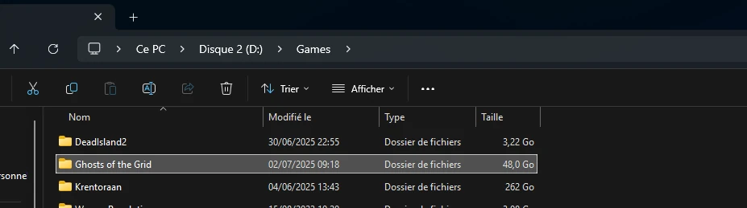

# Installation

## Pre-Installation

### Game Version and Updates

Ghost of the Grid needs Phantom Liberty and the exact Cyberpunk 2077 patch given in the table of the [Preamble]({{ '/ghost-of-the-grid/installation-guide/' | relative_url }}). A game update breaks the list's frameworks until the list itself is updated, so stop the game from updating on its own:

- **GOG Galaxy**: on the Cyberpunk 2077 page, click the settings icon next to **Play** → **Manage installation** → **Configure...** and untick **Automatically update to the newest version**.
- **Steam**: Steam has no switch for this. Right-click Cyberpunk 2077 → **Properties** → **Local Files** → **Browse**, go up two folders to `steamapps`, open the properties of `appmanifest_1091500.acf` and tick **Read-only**. Untick it when you want to update again.

Details and screenshots: [Preventing auto-updates](https://wiki.redmodding.org/cyberpunk-2077-modding/for-mod-users/users-modding-cyberpunk-2077/users-downgrading-preventing-auto-updates) on the REDmodding wiki.

**Keep the game on the patch your list version needs. Do not update or downgrade it while the list is installed.**

### Start From an Unmodded Game

If you modded Cyberpunk 2077 before (Vortex, manual installs), remove those mods first. Verifying the game files in Steam or GOG repairs the game's own files but does not delete mod files. The REDmodding wiki's [troubleshooting page](https://wiki.redmodding.org/cyberpunk-2077-modding/for-mod-users/user-guide-troubleshooting) explains how to get back to a clean game.

### REDmod

REDmod is not needed. Since version 3.2.0.0 the list contains no REDmod mods (see the changelog), so you do not have to install the REDmod DLC.

### Install Location

There is no workaround for a pirated copy of Cyberpunk 2077, or pirated Phantom Liberty DLC. If you ask for support with anything pirated, you will be banned.

{: .warning}
> **WARNING**
>
> Do not put the game, Wabbajack, the list or its downloads in folders managed by Windows: Program Files, Program Files (x86), Desktop, Documents, Downloads, OneDrive. Steam and GOG Galaxy install games in Program Files (x86) by default: if yours is there, move it to another library folder first.

Windows limits file paths to 260 characters by default, so keep the install path short, for example `D:\Games\Ghost of the Grid`.

{: .note }
The list cannot be installed in the Wabbajack folder or in the game folder. They must be completely separated.

Here is an example of a well-configured game folder:
 Games" width="927" height="259">

## Accounts and Websites

For the Wabbajack installation to proceed without issues, you must connect to or create accounts for:
- [Nexus Mods](https://www.nexusmods.com/)

With Nexus Mods Premium, Wabbajack downloads every file on its own. Without Premium, Wabbajack opens each Nexus file page in your browser and picks the file up once you start the download: the list has more than 1,300 archives, so this takes a long time.

# Installation

## Pré-Installation

### Version du Jeu et Mises à Jour

Ghost of the Grid a besoin de Phantom Liberty et du patch exact de Cyberpunk 2077 indiqué dans le tableau du [Préambule]({{ '/ghost-of-the-grid/installation-guide/' | relative_url }}). Une mise à jour du jeu casse les frameworks de la liste jusqu'à ce que la liste elle-même soit mise à jour : empêchez donc le jeu de se mettre à jour tout seul.

- **GOG Galaxy** : sur la page de Cyberpunk 2077, cliquez sur l'icône de réglages à côté du bouton de lancement → **Manage installation** → **Configure...**, puis décochez la mise à jour automatique (**Automatically update to the newest version** dans l'interface anglaise).
- **Steam** : Steam n'a pas d'option pour cela. Clic droit sur Cyberpunk 2077 → **Propriétés** → **Fichiers locaux** → **Parcourir**, remontez de deux dossiers jusqu'à `steamapps`, ouvrez les propriétés de `appmanifest_1091500.acf` et cochez **Lecture seule**. Décochez-la quand vous voudrez mettre à jour.

Détails et captures : [Preventing auto-updates](https://wiki.redmodding.org/cyberpunk-2077-modding/for-mod-users/users-modding-cyberpunk-2077/users-downgrading-preventing-auto-updates) sur le wiki REDmodding (en anglais).

**Gardez le jeu sur le patch demandé par votre version de la liste. Ne le mettez pas à jour et ne le rétrogradez pas tant que la liste est installée.**

### Partir d'un Jeu Sans Mods

Si vous avez déjà moddé Cyberpunk 2077 (Vortex, installation manuelle), retirez d'abord ces mods. Vérifier les fichiers du jeu dans Steam ou GOG répare les fichiers du jeu mais ne supprime pas les fichiers des mods. La [page de dépannage](https://wiki.redmodding.org/cyberpunk-2077-modding/for-mod-users/user-guide-troubleshooting) du wiki REDmodding (en anglais) explique comment revenir à un jeu propre.

### REDmod

REDmod n'est pas nécessaire. Depuis la version 3.2.0.0, la liste ne contient plus aucun mod REDmod (voir le journal des modifications) : vous n'avez pas besoin d'installer le DLC REDmod.

### Emplacement d'Installation

Il n'y a pas de solution de contournement pour une copie piratée de Cyberpunk 2077 ou du DLC Phantom Liberty piraté. Si vous demandez de l'aide pour quoi que ce soit de piraté, vous serez banni.

{: .warning}
> **AVERTISSEMENT**
>
> Ne placez ni le jeu, ni Wabbajack, ni la liste, ni ses téléchargements dans les dossiers gérés par Windows : Program Files, Program Files (x86), Bureau, Documents, Téléchargements, OneDrive. Steam et GOG Galaxy installent les jeux dans Program Files (x86) par défaut : si c'est votre cas, déplacez d'abord le jeu vers une autre bibliothèque.

Windows limite par défaut les chemins de fichiers à 260 caractères : gardez un chemin d'installation court, par exemple `D:\Games\Ghost of the Grid`.

{: .note }
La liste ne peut pas être installée dans le dossier de Wabbajack ni dans le dossier du jeu. Ils doivent être complètement séparés.

Voici un exemple de dossier de jeu bien configuré :
 Games" width="927" height="259">

## Comptes et Sites Web

Pour que l'installation Wabbajack se déroule sans problème, vous devez vous connecter à ou créer des comptes sur :
- [Nexus Mods](https://www.nexusmods.com/)

Avec Nexus Mods Premium, Wabbajack télécharge tous les fichiers seul. Sans Premium, Wabbajack ouvre la page de chaque fichier Nexus dans votre navigateur et récupère le fichier dès que vous lancez le téléchargement : la liste compte plus de 1 300 archives, cela prend donc beaucoup de temps.

