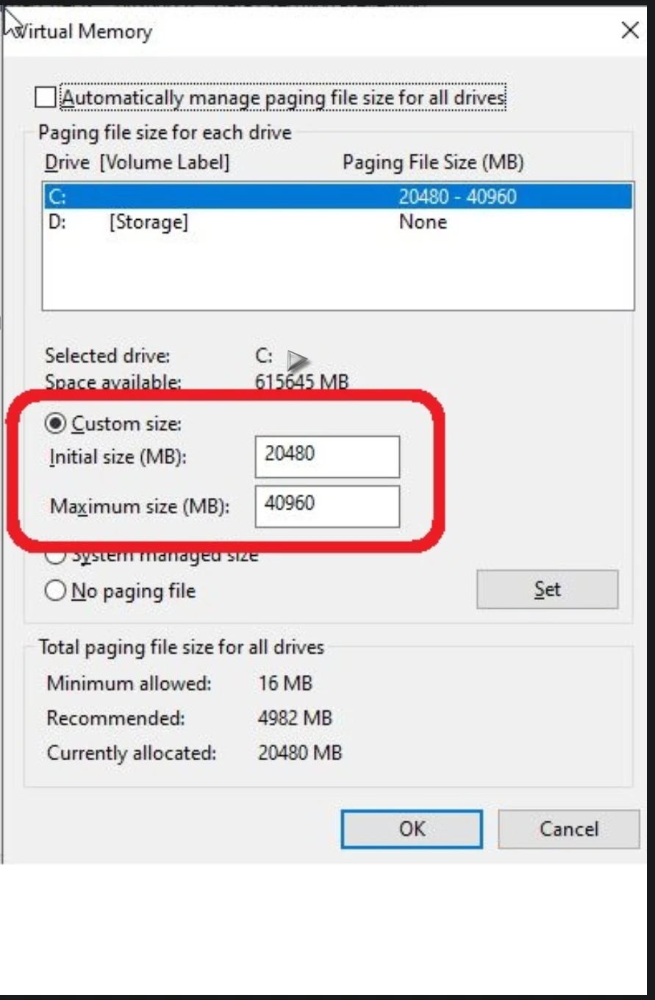
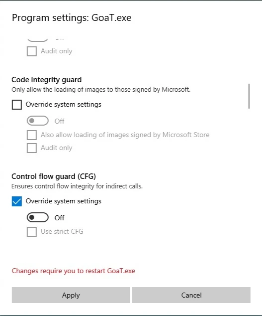

# System Requirements & Necessary Tools

## System Requirements

Only Windows 10 and 11 fully support Wabbajack. LTSC, special variants, lightened editions or any other modified variant **WILL NOT WORK**. Your Windows version **must be 21H2 or newer** to run both Wabbajack and Ghost of the Grid.

Running the list from Hard Disk Drives or external drives is **STRONGLY ADVISED AGAINST**. A lot of content is swapped at game run time and, as a result, fast storage and RAM are needed.

As Ghost of the Grid is a modlist based on graphics, you must have a good graphics card.

# Configuration Requise & Outils Nécessaires

## Configuration Requise

Seuls Windows 10 et 11 prennent entièrement en charge Wabbajack. Les variantes LTSC, éditions spéciales ou allégées **NE FONCTIONNERONT PAS**. Votre version de Windows **doit être 21H2 ou plus récente**.

Exécuter la liste depuis des disques durs (HDD) ou des lecteurs externes est **FORTEMENT DÉCONSEILLÉ**. Une grande quantité de contenu est échangée lors de l'exécution du jeu.

Comme Ghost of the Grid est une modlist axée sur les graphismes, vous devez disposer d'une bonne carte graphique.

<strong>Space required:</strong> Loading... in total, including Loading... for the install and Loading... for the downloads.

<strong>Espace nécessaire :</strong> Loading... au total, dont Loading... pour l'installation et Loading... pour les téléchargements.

> If the space requirement is uncomfortable, remember that you can delete downloads once the list is successfully installed.
{: .note }

| Configuration         | CPU        | GPU                | RAM          | Storage                | Display          | FPS |
|-----------------------|------------|--------------------|--------------|------------------------|------------------|-----|
| **Minimum Specs**     | i5-7600k   | Nvidia RTX 2080    | 16 GB DDR4   | SATA SSD, space above  | FHD 60 Hz        | 45  |
| **Recommended Specs** | i7-9700k   | Nvidia RTX 3060 Ti | 32 GB DDR4   | 1 TB SATA III/M.2 SSD  | FHD 60 Hz        | 60  |
| **Author's Specs**    | i5-10400f  | Nvidia RTX 3090    | 32 GB DDR4   | 1 TB M.2 SSD           | 2K 180 Hz        | 60+ |

## Necessary And Useful Applications

Wabbajack ships with the .NET runtime it needs: you don't have to install .NET separately.

Install the latest [Microsoft Visual C++ Redistributable (x64)](https://aka.ms/vc14/vc_redist.x64.exe), the permanent link Microsoft gives for the current version.

## PageFile Configuration

**Bigger Cyberpunk modlists** need a lot of memory. **Never disable the pagefile.**

1. Press **Windows + R** → type `sysdm.cpl,3` → **Enter**
2. **Performance** → **Settings** → **Advanced** → **Virtual memory** → **Change…**
3. Disable **Automatically manage...** → **Custom size:** Initial 20480 / Maximum 40960
4. **Set** → **Apply** → **OK** → Restart

---

**THIS IS NOT OPTIONAL, YOU CANNOT SKIP THIS STEP EVEN IF YOU HAVE 256 GB OF RAM.**

## Exclusions and AntiVirus

- Exclude **1)** `Cyberpunk2077.exe` (in `bin\x64` of the game folder), **2)** the game folder, **3)** the Ghost of the Grid install and downloads folders, and **4)** the shader cache folder from antivirus
- Exclude from Control Flow Guard: Start → **Exploit Protection** → **Program Settings** → Add **Cyberpunk2077.exe** → **Control flow guard (CFG)** → **Override** → **Off**. The screenshot shows these settings for another program: use `Cyberpunk2077.exe`.

> Si l'espace requis vous pose problème, sachez que vous pouvez supprimer les téléchargements une fois l'installation terminée.
{: .note }

| Configuration          | CPU        | GPU                 | RAM          | Stockage               | Écran            | FPS |
|------------------------|------------|---------------------|--------------|------------------------|------------------|-----|
| **Config. Minimum**    | i5-7600k   | Nvidia RTX 2080     | 16 Go DDR4   | SSD SATA, place ci-dessus | FHD 60 Hz        | 45  |
| **Config. Recommandée**| i7-9700k   | Nvidia RTX 3060 Ti  | 32 Go DDR4   | 1 To SATA III/M.2 SSD  | FHD 60 Hz        | 60  |
| **Config. de l'Auteur**| i5-10400f  | Nvidia RTX 3090     | 32 Go DDR4   | 1 To M.2 SSD           | 2K 180 Hz        | 60+ |

## Applications Nécessaires et Utiles

Wabbajack embarque le runtime .NET dont il a besoin : inutile d'installer .NET à part.

Installez la dernière version de [Microsoft Visual C++ Redistributable (x64)](https://aka.ms/vc14/vc_redist.x64.exe), le lien permanent fourni par Microsoft pour la version actuelle.

## Configuration du Fichier d'Échange

**Les grandes modlists Cyberpunk** nécessitent beaucoup de mémoire. **Ne désactivez jamais le fichier d'échange.**

1. **Windows + R** → tapez `sysdm.cpl,3` → **Entrée**
2. **Performances** → **Paramètres** → **Avancé** → **Mémoire virtuelle** → **Modifier…**
3. Désactivez **Gérer automatiquement...** → **Taille personnalisée :** Initial 20480 / Maximum 40960
4. **Définir** → **Appliquer** → **OK** → Redémarrez

---

**CETTE ÉTAPE N'EST PAS OPTIONNELLE, MÊME AVEC 256 GO DE RAM.**

## Exclusions et Antivirus

- Excluez de votre antivirus **1)** `Cyberpunk2077.exe` (dans `bin\x64` du dossier du jeu), **2)** le dossier du jeu, **3)** les dossiers d'installation et de téléchargements de Ghost of the Grid, et **4)** le dossier du cache de shaders
- Excluez du Control Flow Guard : Démarrer → **Protection contre les attaques** → **Paramètres du programme** → Ajoutez **Cyberpunk2077.exe** → **Protection du flux de contrôle (CFG)** → **Remplacer** → **Désactivé**. La capture montre ces réglages pour un autre programme : utilisez `Cyberpunk2077.exe`.

