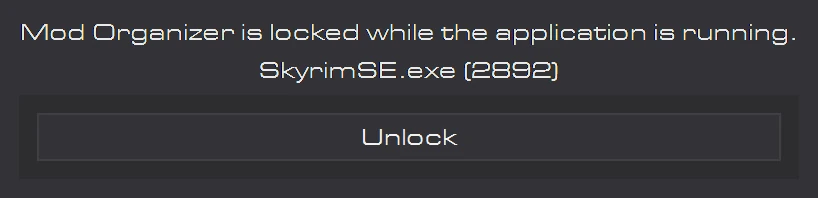

# Using The List

## Starting The List

Open `ModOrganizer.exe` in your Ghost of the Grid folder, pick **Ghost of the Grid** in the executable dropdown at the top right and press **Run**. This executable starts `Cyberpunk2077.exe` with `--launcher-skip -skipStartScreen`, so the CD Projekt launcher and the start screen are skipped. Loading may take some time. **THIS IS NORMAL. DON'T PANIC!**

{: .note }
You can create a desktop shortcut in the shortcuts dropdown.

{: .warning }
> Do not launch the game through Steam or GOG. This will launch vanilla Cyberpunk 2077.

{: .warning }
> Add the list to your antivirus exceptions list.

The Cyber Engine Tweaks overlay (mod menus, console) opens with the **End** key: the list sets this key in all three profiles.

## Do Not Click Unlock!

Mod Organizer locks your mods and load order while running an executable. Clicking unlock may corrupt your game experience.

  

## Switching Profiles

This modlist comes with three profiles. Each one has its own mods and its own game settings:

- **Ghost of the Grid - Performance**: ray tracing off, Medium textures, lower shadow, fog and reflection settings, low crowd density. It leaves out the heavier texture and lighting mods of Standard (Environment Textures Overhaul, Praedy's 77 Retexture, Better Surfaces and Tree Textures, the ray tracing fixes, Impact FX, Realistic Footprints).
- **Ghost of the Grid - Standard** (selected after install): ray tracing on (reflections, sun and local shadows, ray traced lighting on Medium), High textures, standard crowd density.
- **Ghost of the Grid - Ultra**: path tracing with DLSS Ray Reconstruction and DLSS Multi Frame Generation, high crowd density, plus Improved Environment LODs, Improved Distant Shadows and Reflections, CyberVision Reshade and a few world additions. Its default difficulty is Very Hard (Hard in the other two). Pick it only with a high-end Nvidia RTX card.

All three profiles ship with a 2560x1440 resolution and DLSS upscaling and frame generation turned on. On first launch, check **Settings** → **Graphics** and set your own resolution and upscaler, especially with an AMD or Intel graphics card.

Switch between them using the profile dropdown in the upper left of MO2.

## Updating

- Always check the Changelog before updating
- **Backup your saves** or start fresh after updates
- Wabbajack will delete all files not part of the modlist when updating

The full procedure, with what the update keeps and deletes: [Updating the List]({{ '/ghost-of-the-grid/installation-guide/updating/' | relative_url }}).

# Utiliser la Liste

## Démarrer la Liste

Ouvrez `ModOrganizer.exe` dans votre dossier Ghost of the Grid, choisissez **Ghost of the Grid** dans la liste déroulante des exécutables en haut à droite et appuyez sur **Run** (Lancer). Cet exécutable démarre `Cyberpunk2077.exe` avec `--launcher-skip -skipStartScreen` : le launcher de CD Projekt et l'écran titre sont passés. Le chargement peut prendre du temps. **C'EST NORMAL. NE PANIQUEZ PAS !**

{: .note }
Vous pouvez créer un raccourci bureau dans le menu déroulant des raccourcis.

{: .warning }
> Ne lancez pas le jeu via Steam ou GOG. Cela lancera Cyberpunk 2077 vanilla.

{: .warning }
> Ajoutez la liste aux exceptions de votre antivirus.

L'overlay de Cyber Engine Tweaks (menus des mods, console) s'ouvre avec la touche **Fin** (End) : la liste règle cette touche dans les trois profils.

## Ne Cliquez Pas sur Déverrouiller !

Mod Organizer verrouille vos mods et l'ordre de chargement pendant l'exécution. Cliquer sur déverrouiller peut corrompre votre expérience de jeu.

  

## Changer de Profil

Cette modlist propose trois profils. Chacun a ses propres mods et ses propres réglages du jeu :

- **Ghost of the Grid - Performance** : ray tracing désactivé, textures en Moyen, ombres, brouillard et reflets plus bas, faible densité de foule. Il n'inclut pas les mods de textures et d'éclairage les plus lourds du profil Standard (Environment Textures Overhaul, Praedy's 77 Retexture, Better Surfaces et Tree Textures, les correctifs de ray tracing, Impact FX, Realistic Footprints).
- **Ghost of the Grid - Standard** (sélectionné après l'installation) : ray tracing activé (reflets, ombres du soleil et ombres locales, éclairage en ray tracing sur Moyen), textures en Élevé, densité de foule standard.
- **Ghost of the Grid - Ultra** : path tracing avec DLSS Ray Reconstruction et DLSS Multi Frame Generation, forte densité de foule, plus Improved Environment LODs, Improved Distant Shadows and Reflections, CyberVision Reshade et quelques ajouts au monde. Sa difficulté par défaut est Très difficile (Difficile dans les deux autres). Choisissez-le seulement avec une carte Nvidia RTX haut de gamme.

Les trois profils sont livrés en résolution 2560x1440, avec l'upscaling et la génération d'images DLSS activés. Au premier lancement, vérifiez **Paramètres** → **Graphismes** et réglez votre résolution et votre upscaler, surtout avec une carte graphique AMD ou Intel.

Changez de profil via le menu déroulant en haut à gauche de MO2.

## Mise à Jour

- Consultez toujours le journal des modifications avant de mettre à jour
- **Sauvegardez vos sauvegardes** ou commencez une nouvelle partie après les mises à jour
- Wabbajack supprimera tous les fichiers ne faisant pas partie de la modlist lors des mises à jour

La procédure complète, avec ce que la mise à jour garde et supprime : [Mettre à jour la liste]({{ '/ghost-of-the-grid/installation-guide/updating/' | relative_url }}).

