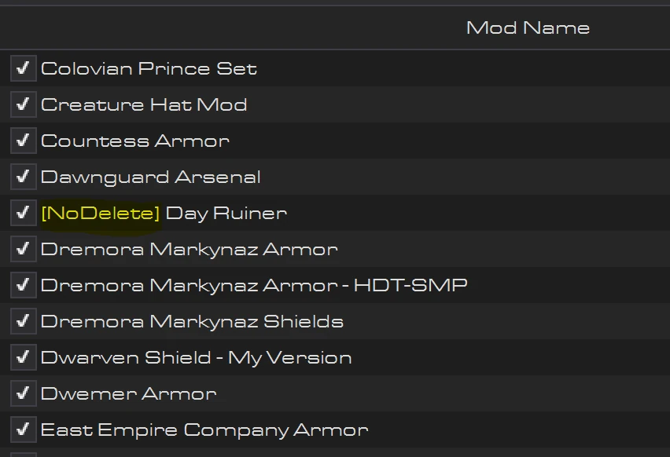



# Questions & Answers

## Reporting an Issue

If during your playthrough you encounter any bug or incompatibility, head over to my Discord server and share it in the dedicated channel so I can fix it in a future update.

### Share your crash log

**Crash Log Location:**
`Documents/My Games/Skyrim Special Edition/SKSE/crash-202x-xx-xx-xx-xx-xx.log`

## INI Configuration

Open BethINI and check:
- Shadow Resolution: 2048
- Ambient Occlusion: Use either this or the ENB version. Do not have both turned on.

## Mods Configuration

The modlist is exclusively in 2K. You can lower clutter retextures to 1K if needed.

Mod tags:
- **Basic Fomod**: Regular fomod with add-ons only.
- **Patches Fomod**: Contains patches and add-ons.
- **Unpublished**: Self-explanatory.
- **Output**: Files generated for the list. Regenerate if needed.

### Saving Your Mod Changes

Before updating, add the prefix `[NoDelete]` to any mods you've added. Copy `loadorder.txt` from your profiles folder outside of the Krentoraan installation before updating.

  

If you have more questions, join my Discord Server!

# Questions & Réponses

## Signaler un Problème

Si au cours de votre partie vous rencontrez un bug ou une incompatibilité, rendez-vous sur mon serveur Discord et partagez-le dans le canal dédié pour que je puisse le corriger dans une future mise à jour.

### Partager votre journal de crash

**Emplacement du journal de crash :**
`Documents/My Games/Skyrim Special Edition/SKSE/crash-202x-xx-xx-xx-xx-xx.log`

## Configuration des INIs

Ouvrez BethINI et vérifiez :
- Résolution des ombres : 2048
- Occlusion Ambiante : Utilisez soit celle-ci, soit la version ENB. N'activez pas les deux.

## Configuration des Mods

La modlist est exclusivement en 2K. Vous pouvez abaisser les retextures à 1K si nécessaire.

Balises de mods :
- **Basic Fomod** : Fomod classique avec extensions uniquement.
- **Patches Fomod** : Contient des correctifs et extensions.
- **Unpublished** : Non publié.
- **Output** : Fichiers générés. Régénérez si nécessaire.

### Sauvegarder Vos Modifications

Avant de mettre à jour, ajoutez le préfixe `[NoDelete]` aux mods que vous avez ajoutés. Copiez `loadorder.txt` depuis votre dossier de profils en dehors de l'installation de Krentoraan.

  

Si vous avez d'autres questions, rejoignez mon serveur Discord !

