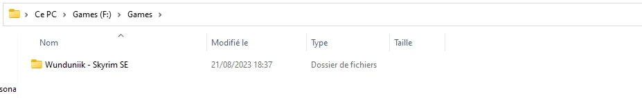

# Installation

## Pre-Installation

### Necessary Tweaks

Before installing the modlist, here are some things you must do:
There is no workaround for a pirated copy of Skyrim, or pirated Creation Club content. If you ask for support with anything pirated, you will be banned.

- Install Skyrim Special Edition from Steam with the **Anniversary Edition** upgrade. The list uses all the Creation Club content included in Anniversary Edition.
- Set the game language to **English** in Steam (game properties, Language). Wabbajack needs the English voice files.
- Krentoraan 1.3.0 needs the files of game version 1.6.1170, and Steam now installs a newer version. Wabbajack fixes this itself once you log in to Steam inside it (see [Wabbajack Installation]({{ '/krentoraan/installation-guide/wabbajack-installation/' | relative_url }})).

{: .warning}
> **WARNING**
>
> If your Steam library is in Program Files, refer to [this](https://github.com/LostDragonist/steam-library-setup-tool/wiki/Usage-Guide) guide to move it elsewhere. Do not install to default Windows folders (Desktop, Documents, Downloads, etc.) as this will cause issues.

In the Windows API (with some exceptions), the maximum length for a file path is 260 characters.

{: .note }
The list cannot be installed in the same folders that Wabbajack is in. They must be completely separated. Do not install it inside the Skyrim game folder, in Program Files or in OneDrive either.

Here is an example of a well-configured modlist installation folder:
 Games > Wunduniik - Skyrim SE" width="927" height="142">

**YOU SHALL NOT DOWNGRADE THE GAME. DOING SO WILL CAUSE INSTALLATION ISSUES.**

## Accounts and Websites

For the Wabbajack installation to proceed without issues, you must connect to or create accounts for the following websites:
- [Nexus Mods](https://www.nexusmods.com/) (Premium recommended for faster installation)
- Steam, inside Wabbajack: needed so that Wabbajack can download the 1.6.1170 game files from Steam.

# Installation

## Pré-Installation

### Modifications Nécessaires

Avant d'installer la modlist, voici quelques choses que vous devez faire :
Il n'y a pas de solution de contournement pour une copie piratée de Skyrim ou du contenu Creation Club piraté. Si vous demandez de l'aide pour quoi que ce soit de piraté, vous serez banni.

- Installez Skyrim Special Edition depuis Steam avec la mise à niveau **Anniversary Edition**. La liste utilise tout le contenu Creation Club inclus dans l'Anniversary Edition.
- Réglez la langue du jeu sur **anglais** dans Steam (propriétés du jeu, Langue). Wabbajack a besoin des fichiers de voix anglais.
- Krentoraan 1.3.0 a besoin des fichiers de la version 1.6.1170 du jeu, et Steam installe désormais une version plus récente. Wabbajack règle cela lui-même une fois connecté à Steam (voir [Installation Wabbajack]({{ '/krentoraan/installation-guide/wabbajack-installation/' | relative_url }})).

{: .warning}
> **AVERTISSEMENT**
>
> Si votre bibliothèque Steam se trouve dans Program Files, consultez [ce](https://github.com/LostDragonist/steam-library-setup-tool/wiki/Usage-Guide) guide pour la déplacer. N'installez pas dans les dossiers Windows par défaut (Bureau, Documents, Téléchargements, etc.) car cela causera des problèmes.

Dans l'API Windows (avec quelques exceptions), la longueur maximale d'un chemin de fichier est de 260 caractères.

{: .note }
La liste ne peut pas être installée dans les mêmes dossiers que Wabbajack. Ils doivent être complètement séparés. Ne l'installez pas non plus dans le dossier du jeu Skyrim, dans Program Files ou dans OneDrive.

Voici un exemple de dossier d'installation bien configuré :
 Games > Wunduniik - Skyrim SE" width="927" height="142">

**VOUS NE DEVEZ PAS RÉTROGRADER LE JEU. CELA CAUSERA DES PROBLÈMES D'INSTALLATION.**

## Comptes et Sites Web

Pour que l'installation Wabbajack se déroule sans problème, vous devez vous connecter à ou créer des comptes sur :
- [Nexus Mods](https://www.nexusmods.com/) (Premium recommandé pour une installation plus rapide)
- Steam, dans Wabbajack : nécessaire pour que Wabbajack télécharge les fichiers 1.6.1170 du jeu depuis Steam.

