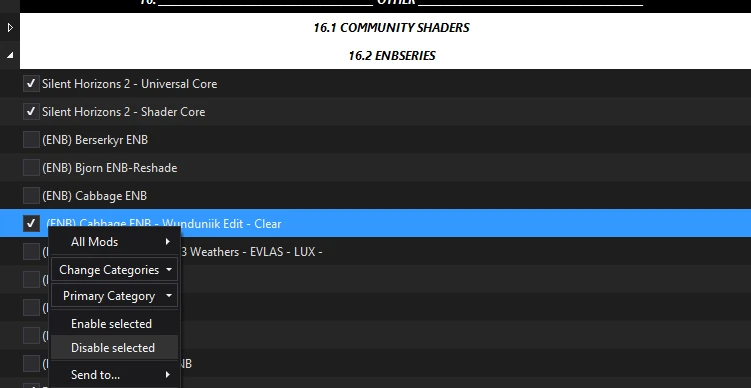
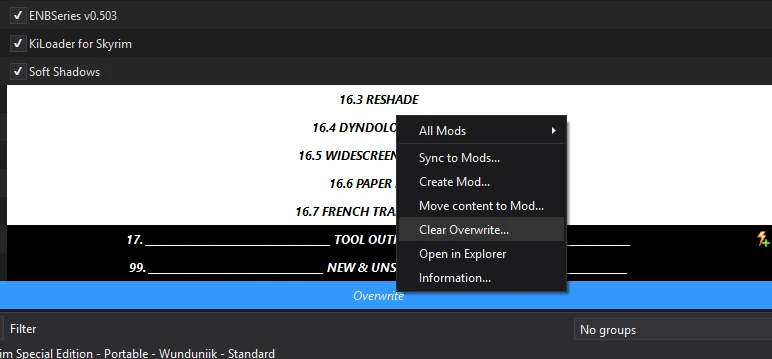
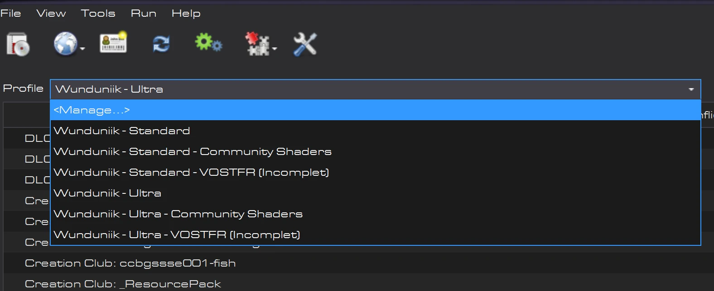

# Post Installation

## BethINI and INIs

BethINI is a really useful tool to edit your Skyrim INI files. I already provided my INIs, but some lines might not be set up correctly for your computer. Here are the lines you must check:

1. SkyrimPrefs.ini:
   - `iSize H=1080` → Change to your screen resolution Height
   - `iSize W=1920` → Change to your screen resolution Width
   - `sD3DDevice="NVIDIA GeForce RTX 3060TI"` → Change to your GPU name

2. SSEDisplayTweaks.ini:
   - `Resolution=1920x1080` → Change to your screen resolution

## Switching ENB Preset

Krentoraan was designed to be used with Cabbage ENB for NAT III Weather. Krentoraan uses Root Builder. To change the ENB:

1. Disable the current active preset ((ENB) Cabbage ENB - Krentoraan Edit - Clear by default):

    

2. Enable the preset you want to use.
3. Clear overwrite to delete the ENB Shader Cache:

    

## Increasing Krentoraan Performance

### Profile Options

Krentoraan comes with 3 profiles: Performance, Standard, and Ultra, automatically assigned based on your screen resolution and VRAM:
- **Performance** (0–8 GB VRAM): Sparse Forest with lower density flora
- **Standard** (8–14 GB VRAM): Sparse Forests with realistic trees and dense flora
- **Ultra** (14+ GB VRAM): Dense Forests with ultra dense flora and Grass Lods

    

### External Performance Tools

{: .note }
These tools are optional.

- **Magpie (free):** [https://github.com/Blinue/Magpie](https://github.com/Blinue/Magpie)
- **PureDark's DLSS Mod (~$5):** Search on Patreon.
- **Lossless Scaling (~$7):** Available on Steam.

# Post-Installation

## BethINI et INIs

BethINI est un outil très utile pour modifier vos fichiers INI de Skyrim. J'ai déjà fourni mes INIs, mais certaines lignes pourraient ne pas être correctement configurées. Voici les lignes à vérifier :

1. SkyrimPrefs.ini :
   - `iSize H=1080` → Remplacez par la hauteur de votre résolution
   - `iSize W=1920` → Remplacez par la largeur de votre résolution
   - `sD3DDevice="NVIDIA GeForce RTX 3060TI"` → Remplacez par le nom de votre GPU

2. SSEDisplayTweaks.ini :
   - `Resolution=1920x1080` → Remplacez par votre résolution d'écran

## Changer le Preset ENB

Krentoraan a été conçu pour Cabbage ENB for NAT III Weather. Krentoraan utilise Root Builder. Pour changer l'ENB :

1. Désactivez le preset actif ((ENB) Cabbage ENB - Krentoraan Edit - Clear par défaut) :

    

2. Activez le preset souhaité.
3. Videz l'overwrite pour supprimer le cache de shaders ENB :

    

## Améliorer les Performances de Krentoraan

### Options de Profils

Krentoraan est livré avec 3 profils : Performance, Standard et Ultra, assignés automatiquement selon votre résolution et VRAM :
- **Performance** (0–8 Go VRAM) : Forêt clairsemée, flore moins dense
- **Standard** (8–14 Go VRAM) : Forêts clairsemées avec arbres réalistes et flore dense
- **Ultra** (14+ Go VRAM) : Forêts denses avec flore ultra dense et LODs d'herbe

    

### Outils de Performance Externes

{: .note }
Ces outils sont optionnels.

- **Magpie (gratuit) :** [https://github.com/Blinue/Magpie](https://github.com/Blinue/Magpie)
- **Mod DLSS de PureDark (~5$) :** Recherchez sur Patreon.
- **Lossless Scaling (~7$) :** Disponible sur Steam.

