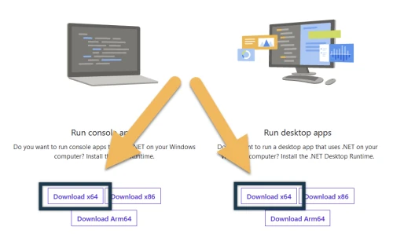
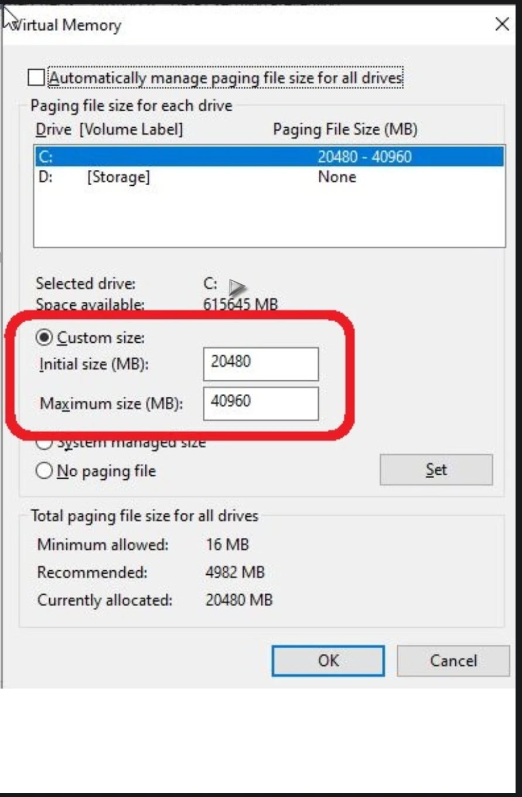
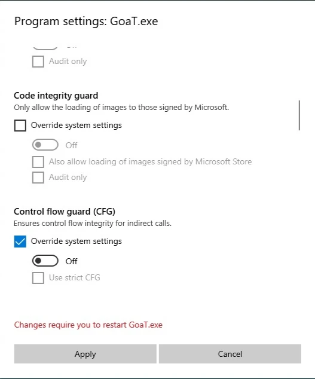

# System Requirements

## System Requirements

Only Windows 10 and 11 fully support Wabbajack. LTSC, special variants, lightened editions or any other modified variant **WILL NOT WORK**. Your Windows version **must be 21H2 or newer** to run both Wabbajack and Krentoraan.

Running the list from Hard Disk Drives or external drives is **STRONGLY ADVISED AGAINST**. A lot of content is swapped at game run time and, as a result, fast storage and RAM are needed.

As Krentoraan is a modlist based on graphics, you must have a good graphics card.

# Configuration Requise

## Configuration Requise

Seuls Windows 10 et 11 prennent entièrement en charge Wabbajack. Les variantes LTSC, éditions spéciales, allégées ou toute autre variante modifiée **NE FONCTIONNERONT PAS**. Votre version de Windows **doit être 21H2 ou plus récente** pour faire fonctionner Wabbajack et Krentoraan.

Exécuter la liste depuis des disques durs (HDD) ou des lecteurs externes est **FORTEMENT DÉCONSEILLÉ**. Une grande quantité de contenu est échangée lors de l'exécution du jeu, ce qui nécessite un stockage rapide et de la RAM.

Comme Krentoraan est une modlist axée sur les graphismes, vous devez disposer d'une bonne carte graphique.

  <strong>Space required:</strong>
  Loading... total,
  including Loading... for install
  and Loading... for downloads.
  Version

<noscript>
  
<strong>Space required:</strong> about 267 GB total (152 GB install + 115 GB downloads).

</noscript>

> If the space requirement is uncomfortable, remember that you can delete downloads once the list is successfully installed. You can also set your download location to a different drive than the installation location.
{: .note }

| Configuration         | CPU        | GPU                | RAM          | Storage                | Display          | FPS |
|-----------------------|------------|--------------------|--------------|------------------------|------------------|-----|
| **Minimum Specs**     | i5-7600k   | Nvidia GTX 2080    | 16 GB DDR4   | 500 GB SATA II SSD     | FHD 60 Hz        | 45  |
| **Recommended Specs** | i7-9700k   | Nvidia RTX 3060 Ti | 32 GB DDR4   | 1 TB SATA III/M.2 SSD  | FHD 60 Hz        | 60  |
| **Author's Specs**    | i5-10400f  | Nvidia RTX 3090    | 32 GB DDR4   | 1 TB M.2 SSD           | 2K 180 Hz        | 60+ |

## Necessary And Useful Applications

For the modlist to work you must have some apps: Please ensure you have the latest .NET Runtime installed. Download the desktop app installer and console app x64 from Microsoft here:
[https://dotnet.microsoft.com/en-us/download](https://dotnet.microsoft.com/en-us/download), and also the latest [Visual C++ Redistributable x64](https://aka.ms/vc14/vc_redist.x64.exe). Wabbajack itself already includes its own .NET runtime.

     

To help you with the INIs configuration, I highly recommend installing [Sublime Text](https://www.sublimetext.com/)

## PageFile Configuration

**Bigger Skyrim modlists** need a lot of memory, and when there is not enough available it may fail allocating more.

To fix this, you'll want to have a bigger pagefile. A pagefile is a file on your disk Windows will use when there is not enough RAM available.

**Never disable the pagefile**: this may lead to various issues on your system. If you've never touched the pagefile, try performing the following steps:

1. Press **Windows + R** on your keyboard
2. Type `sysdm.cpl,3`
3. Press **Enter**
4. Under the **Performance** section, press **Settings**
5. Click the **Advanced** tab at the top
6. At the **Virtual memory** section press **Change…**
7. Disable **Automatically manage paging file size for all drives**
8. Click **Custom size:**
   - **Initial size (MB):** 20480
   - **Maximum size (MB):** 40960
9. Click **Set**
10. Click **Apply** & **OK**
11. Press **Yes** to restart
12. Restart your computer

---

**THIS IS NOT OPTIONAL, YOU CANNOT SKIP THIS STEP EVEN IF YOU HAVE 256 GB OF RAM.**

## Exclusions and AntiVirus

- Exclude **1)** `SkyrimSE.exe` and `skse64_loader.exe`, **2)** the Krentoraan install folder (it holds the game copy in `Game Root`), and **3)** the shader cache folder from Windows Defender (or other) antivirus
- The install folder contains `Windows Exclusion.bat`. Right-click it and choose **Run as administrator**: it adds the install folder to the Windows Defender exclusions (answer **A** for automatic, or **M** to open Windows Security and do it yourself). It only works with Windows Defender.
- Also exclude the game from Control Flow Guard:
  1. Click **Start** → Type **Exploit Protection** → **Program Settings**
  2. Click **Add program to customize** → **Add by program name**
  3. Type **SKSE64_Loader.exe**
  4. Scroll to **Control flow guard (CFG)** → **Override** → **Off**

---

> Si l'espace requis vous pose problème, sachez que vous pouvez supprimer les téléchargements une fois la liste installée avec succès. Vous pouvez également définir un emplacement de téléchargement sur un lecteur différent.
{: .note }

| Configuration          | CPU        | GPU                 | RAM          | Stockage               | Écran            | FPS |
|------------------------|------------|---------------------|--------------|------------------------|------------------|-----|
| **Config. Minimum**    | i5-7600k   | Nvidia GTX 2080     | 16 Go DDR4   | 500 Go SATA II SSD     | FHD 60 Hz        | 45  |
| **Config. Recommandée**| i7-9700k   | Nvidia RTX 3060 Ti  | 32 Go DDR4   | 1 To SATA III/M.2 SSD  | FHD 60 Hz        | 60  |
| **Config. de l'Auteur**| i5-10400f  | Nvidia RTX 3090     | 32 Go DDR4   | 1 To M.2 SSD           | 2K 180 Hz        | 60+ |

## Applications Nécessaires et Utiles

Pour que la modlist fonctionne, vous devez disposer de certaines applications. Veuillez vous assurer que le dernier runtime .NET est installé. Téléchargez depuis Microsoft :
[https://dotnet.microsoft.com/fr-fr/download](https://dotnet.microsoft.com/fr-fr/download), ainsi que la dernière version de [Visual C++ Redistributable x64](https://aka.ms/vc14/vc_redist.x64.exe). Wabbajack embarque déjà son propre runtime .NET.

     

Pour la configuration des INIs, je recommande vivement d'installer [Sublime Text](https://www.sublimetext.com/)

## Configuration du Fichier d'Échange (PageFile)

**Les grandes modlists Skyrim** ont besoin de beaucoup de mémoire. Un fichier d'échange plus grand est nécessaire. **Ne désactivez jamais le fichier d'échange.** Si vous ne l'avez jamais modifié, suivez ces étapes :

1. Appuyez sur **Windows + R** → tapez `sysdm.cpl,3` → **Entrée**
2. Dans **Performances** → **Paramètres** → onglet **Avancé** → **Mémoire virtuelle** → **Modifier…**
3. Désactivez **Gérer automatiquement...**
4. Cliquez sur **Taille personnalisée** : initiale 20480 Mo, maximale 40960 Mo
5. **Définir** → **Appliquer** → **OK** → Redémarrez

---

**CETTE ÉTAPE N'EST PAS OPTIONNELLE, MÊME AVEC 256 GO DE RAM.**

## Exclusions et Antivirus

- Excluez **1)** `SkyrimSE.exe` et `skse64_loader.exe`, **2)** le dossier d'installation de Krentoraan (il contient la copie du jeu dans `Game Root`), et **3)** le dossier du cache de shaders de votre antivirus
- Le dossier d'installation contient `Windows Exclusion.bat`. Faites un clic droit dessus et choisissez **Exécuter en tant qu'administrateur** : il ajoute le dossier d'installation aux exclusions de Windows Defender (répondez **A** pour le faire automatiquement, ou **M** pour ouvrir la Sécurité Windows et le faire vous-même). Il ne fonctionne qu'avec Windows Defender.
- Excluez également le jeu du Control Flow Guard :
  1. Démarrer → **Protection contre les attaques** → **Paramètres du programme**
  2. **Ajouter un programme** → **Par nom** → tapez **SKSE64_Loader.exe**
  3. Descendez jusqu'à **Protection du flux de contrôle (CFG)** → **Remplacer** → **Désactivé**

---

