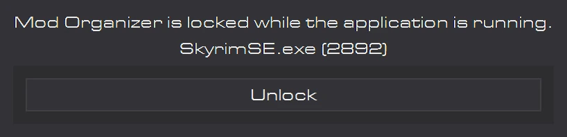
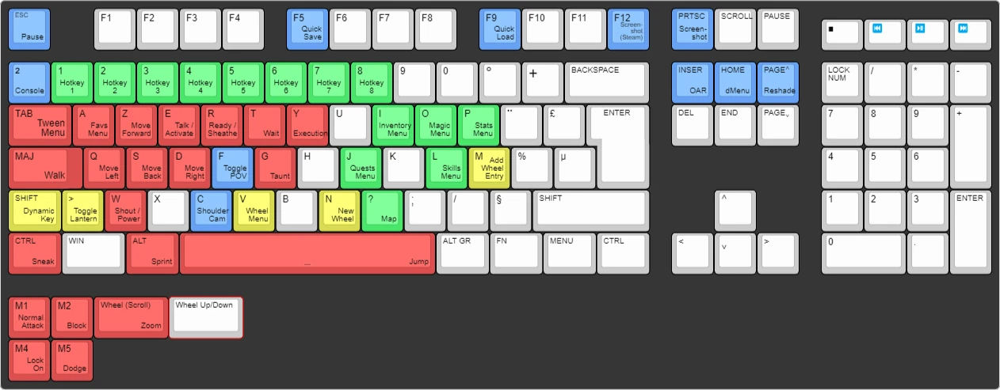

# Using The List

## Starting The List

Open `Mod Organizer.exe` and launch **Krentoraan Launcher** through the executables. As the modlist can be quite large, loading may take some time. **THIS IS NORMAL — DON'T PANIC!**

{: .note }
You can create a desktop shortcut in the shortcuts dropdown.

{: .warning }
> Do not launch the game through Steam. This will launch vanilla Skyrim.

{: .warning }
> Add the list to your antivirus exceptions list.

## Do Not Click Unlock!

Mod Organizer locks your mods and load order while an executable is running. Clicking unlock may corrupt your game experience.

  

## Configuring MCM

All MCMs have been pre-configured via Settings Loader mods. Note the default values before making any changes as they cannot be recovered.

{: .warning }
> Failure to wait for MCMs to finish loading can cause issues and require a new save.

## Keymapping

  

The keymap is also available in-game using the **F8** key. Press Tab to close it.

# Utiliser la Liste

## Démarrer la Liste

Ouvrez `Mod Organizer.exe` et lancez **Krentoraan Launcher** via les exécutables. Le chargement du jeu peut prendre un certain temps. **C'EST NORMAL — NE PANIQUEZ PAS !**

{: .note }
Vous pouvez créer un raccourci bureau dans le menu déroulant des raccourcis.

{: .warning }
> Ne lancez pas le jeu via Steam. Cela lancera Skyrim vanilla.

{: .warning }
> Ajoutez la liste aux exceptions de votre antivirus.

## Ne Cliquez Pas sur Déverrouiller !

Mod Organizer verrouille vos mods et l'ordre de chargement pendant l'exécution. Cliquer sur déverrouiller peut corrompre votre expérience de jeu.

  

## Configuration des MCM

Tous les MCM ont été préconfigurés via des mods Settings Loader. Notez les valeurs par défaut avant de faire des modifications car elles ne peuvent pas être récupérées.

{: .warning }
> Ne pas attendre que les MCM finissent de se charger peut causer des problèmes et nécessiter une nouvelle sauvegarde.

## Raccourcis Clavier

  

La carte des touches est également disponible en jeu avec la touche **F8**. Appuyez sur Tab pour fermer.

