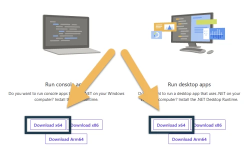
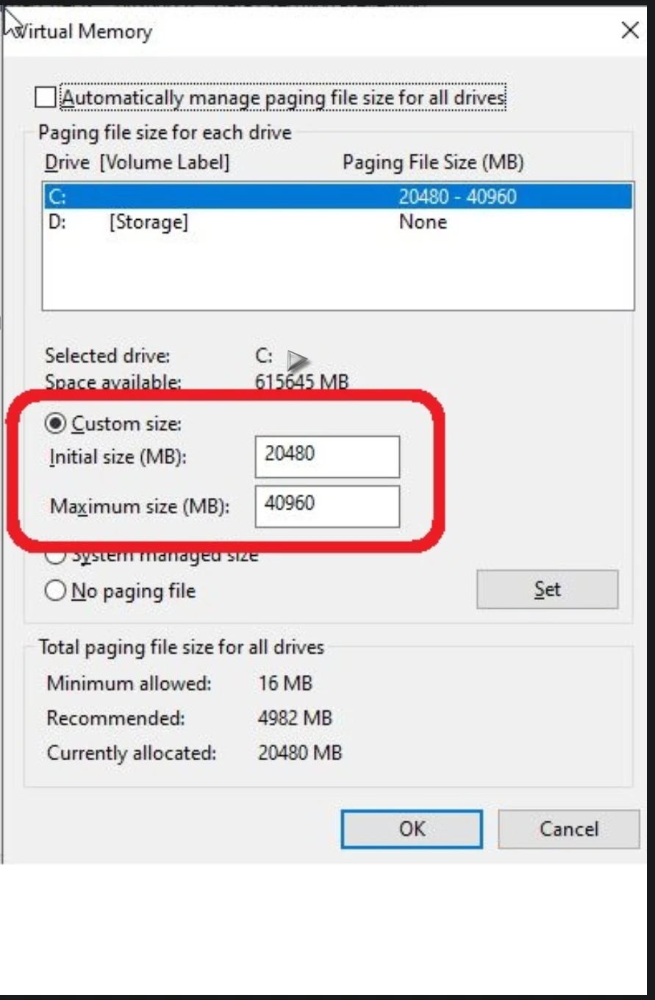
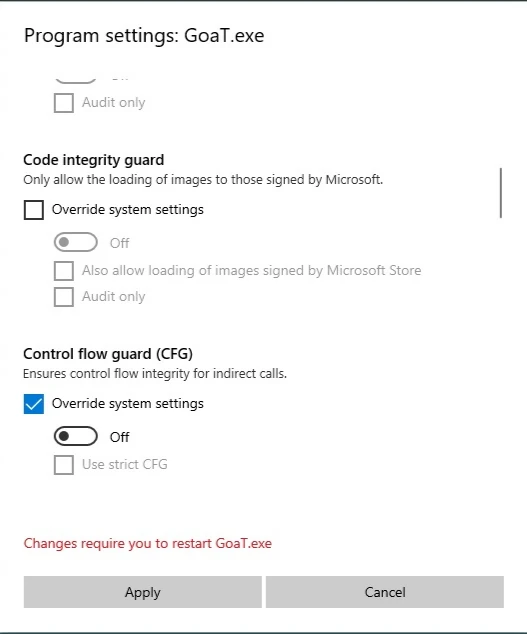

# System Requirements & Necessary Tools

## System Requirements

Only Windows 10 and 11 fully support Wabbajack. LTSC, special variants, lightened editions or any other modified variant **WILL NOT WORK**. Your Windows version **must be 21H2 or newer** to run both Wabbajack and No Man's Sky Explorer.

Running the list from Hard Disk Drives or external drives is **STRONGLY ADVISED AGAINST**.

As No Man's Sky Explorer is a modlist based on graphics, you must have a good graphics card.

# Configuration Requise & Outils Nécessaires

## Configuration Requise

Seuls Windows 10 et 11 prennent entièrement en charge Wabbajack. Les variantes LTSC, éditions spéciales ou allégées **NE FONCTIONNERONT PAS**. Votre version de Windows **doit être 21H2 ou plus récente**.

Exécuter la liste depuis des disques durs (HDD) ou des lecteurs externes est **FORTEMENT DÉCONSEILLÉ**.

Comme No Man's Sky Explorer est une modlist axée sur les graphismes, vous devez disposer d'une bonne carte graphique.

   <strong>Space required:</strong>
   Loading... total,
   including Loading... for install
   and Loading... for downloads.
   Version

<noscript>
   
<strong>Space required:</strong> 12 GB total (approx. 10 GB install + 2 GB downloads).

</noscript>

> If the space requirement is uncomfortable, you can delete downloads once installed.
{: .note }

| Configuration         | CPU        | GPU                | RAM          | Storage                | Display          | FPS  |
|-----------------------|------------|--------------------|--------------|------------------------|------------------|------|
| **Minimum Specs**     | i5-7600k   | Nvidia GTX 2060    | 16 GB DDR4   | 500 GB SATA II SSD     | FHD 60 Hz        | 45   |
| **Recommended Specs** | i7-9700k   | Nvidia RTX 3060 Ti | 32 GB DDR4   | 1 TB SATA III/M.2 SSD  | FHD 60 Hz        | 60+  |
| **Author's Specs**    | i5-10400f  | Nvidia RTX 3090    | 32 GB DDR4   | 1 TB M.2 SSD           | 2K 180 Hz        | 60+  |

## Necessary And Useful Applications

Please ensure you have the latest .NET version installed:
[https://dotnet.microsoft.com/download/dotnet/5.0/runtime](https://dotnet.microsoft.com/download/dotnet/5.0/runtime), and also [Visual C++ x64](https://aka.ms/vs/16/release/vc_redist.x64.exe).

     

## PageFile Configuration

**Bigger NMS modlists** need a lot of memory. **Never disable the pagefile.**

1. Press **Windows + R** → type `sysdm.cpl,3` → **Enter**
2. **Performance** → **Settings** → **Advanced** → **Virtual memory** → **Change…**
3. Disable **Automatically manage...** → **Custom size:** Initial 20480 / Maximum 40960
4. **Set** → **Apply** → **OK** → Restart

---

**THIS IS NOT OPTIONAL, YOU CANNOT SKIP THIS STEP EVEN IF YOU HAVE 256 GB OF RAM.**

## Exclusions and AntiVirus

- Exclude **1)** `NMS.exe`, **2)** the game folder, and **3)** the shader cache folder from antivirus
- Exclude from Control Flow Guard: Start → **Exploit Protection** → **Program Settings** → Add **NMS.exe** → **Control flow guard (CFG)** → **Override** → **Off**

> Si l'espace requis vous pose problème, vous pouvez supprimer les téléchargements une fois l'installation terminée.
{: .note }

| Configuration          | CPU        | GPU                 | RAM          | Stockage               | Écran            | FPS  |
|------------------------|------------|---------------------|--------------|------------------------|------------------|------|
| **Config. Minimum**    | i5-7600k   | Nvidia GTX 2060     | 16 Go DDR4   | 500 Go SATA II SSD     | FHD 60 Hz        | 45   |
| **Config. Recommandée**| i7-9700k   | Nvidia RTX 3060 Ti  | 32 Go DDR4   | 1 To SATA III/M.2 SSD  | FHD 60 Hz        | 60+  |
| **Config. de l'Auteur**| i5-10400f  | Nvidia RTX 3090     | 32 Go DDR4   | 1 To M.2 SSD           | 2K 180 Hz        | 60+  |

## Applications Nécessaires et Utiles

Assurez-vous d'avoir la dernière version de .NET installée :
[https://dotnet.microsoft.com/download/dotnet/5.0/runtime](https://dotnet.microsoft.com/download/dotnet/5.0/runtime), ainsi que [Visual C++ x64](https://aka.ms/vs/16/release/vc_redist.x64.exe).

     

## Configuration du Fichier d'Échange

**Les grandes modlists NMS** nécessitent beaucoup de mémoire. **Ne désactivez jamais le fichier d'échange.**

1. **Windows + R** → tapez `sysdm.cpl,3` → **Entrée**
2. **Performances** → **Paramètres** → **Avancé** → **Mémoire virtuelle** → **Modifier…**
3. Désactivez **Gérer automatiquement...** → **Taille personnalisée :** Initial 20480 / Maximum 40960
4. **Définir** → **Appliquer** → **OK** → Redémarrez

---

**CETTE ÉTAPE N'EST PAS OPTIONNELLE, MÊME AVEC 256 GO DE RAM.**

## Exclusions et Antivirus

- Excluez **1)** `NMS.exe`, **2)** le dossier du jeu, et **3)** le dossier du cache de shaders de votre antivirus
- Excluez du Control Flow Guard : Démarrer → **Protection contre les attaques** → **Paramètres du programme** → Ajoutez **NMS.exe** → **Protection du flux de contrôle (CFG)** → **Remplacer** → **Désactivé**

