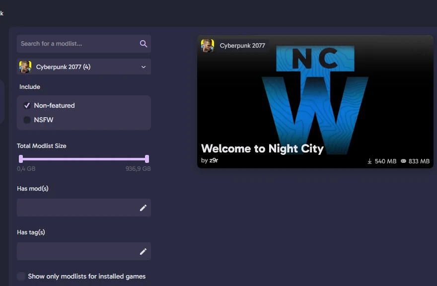

# Wabbajack Installation

## Installation

Once you have completed pre-installation, download the latest version of Wabbajack from its [GitHub releases page](https://github.com/wabbajack-tools/wabbajack/releases) and place it in its own folder, such as `C:\Games\Wabbajack`.

Downloading and installing Ghost of the Grid can take a while. Follow the next steps:

1. Open Wabbajack and click on **Browse lists**.
2. Pick **Cyberpunk 2077** in the game filter and search for **Ghost of the Grid**.
3. Ghost of the Grid is not a featured list: tick **Non-featured** under **Include**, otherwise it stays hidden. **NSFW** can stay unticked.
4. Press the download button on the list and wait for the `.wabbajack` file to download, then press the play button.
5. Set the **Installation Location** to an empty folder such as `C:\Games\Ghost of the Grid`.
6. The **Downloads Location** doesn't need to be on an SSD but it helps.
7. Press **Install**.
8. Go and pet your nearest fluffy animal whilst Wabbajack does its thing.
9. The installation is now complete. Move on to the next section.

 

**Even if Wabbajack says installation complete, this doesn't mean you have finished. You must follow the rest of the installation guide.**

# Installation Wabbajack

## Installation

Une fois la pré-installation terminée, téléchargez la dernière version de Wabbajack sur sa [page GitHub des versions](https://github.com/wabbajack-tools/wabbajack/releases) et placez-le dans son propre dossier, par exemple `C:\Games\Wabbajack`.

Le téléchargement et l'installation de Ghost of the Grid peuvent prendre un certain temps. Suivez les étapes suivantes (Wabbajack n'existe qu'en anglais, les noms des boutons sont donc en anglais) :

1. Ouvrez Wabbajack et cliquez sur **Browse lists**.
2. Choisissez **Cyberpunk 2077** dans le filtre de jeu et recherchez **Ghost of the Grid**.
3. Ghost of the Grid n'est pas une liste mise en avant : cochez **Non-featured** sous **Include**, sinon elle reste masquée. **NSFW** peut rester décoché.
4. Appuyez sur le bouton de téléchargement de la liste et attendez la fin du téléchargement du fichier `.wabbajack`, puis appuyez sur le bouton lecture.
5. Choisissez comme **Installation Location** un dossier vide, par exemple `C:\Games\Ghost of the Grid`.
6. Le dossier **Downloads Location** n'a pas besoin d'être sur un SSD mais cela aide.
7. Appuyez sur **Install**.
8. Allez caresser l'animal le plus proche pendant que Wabbajack travaille.
9. L'installation est terminée. Passez à la section suivante.

 

**Même si Wabbajack dit que l'installation est terminée, vous n'avez pas fini. Vous devez suivre le reste du guide d'installation.**

## Problems With Installation

- If Wabbajack seems stuck, restart it: it will pick up where it left off
- Rerun Wabbajack at least twice before reporting failed downloads
- If a mod updated and old files were deleted, wait for a list update

**Could not download x:**
Big files can fail due to connection issues. Run Wabbajack again or manually download the file to the same location.

## Problèmes d'Installation

- Si Wabbajack semble bloqué, redémarrez-le : il reprendra là où il s'est arrêté
- Relancez Wabbajack au moins deux fois avant de signaler des échecs de téléchargement
- Si un mod a été mis à jour et que les anciens fichiers ont été supprimés, attendez une mise à jour de la liste

**Impossible de télécharger x :**
Les gros fichiers peuvent échouer à cause de problèmes de connexion. Relancez Wabbajack ou téléchargez manuellement le fichier au même emplacement.

