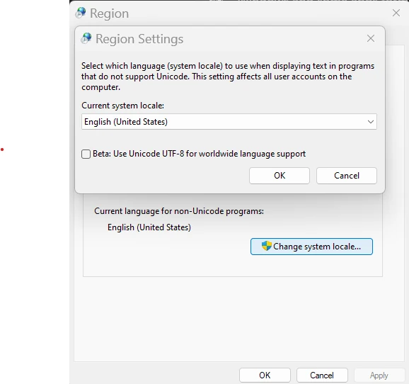

# Wabbajack Installation

## Installation

Once you have completed pre-installation, download the latest version of Wabbajack from [wabbajack.org](https://www.wabbajack.org/) and place it in a folder such as `C:\Games\Wabbajack`. Do not place it in program files, on your desktop or in your downloads folder.

Downloading and installing Krentoraan can take a while depending on your internet connection and computer. Follow the next steps:

1. Open Wabbajack and go to the **Gallery**.
2. Type **Krentoraan** in the search field.
3. Press the download button on Krentoraan and wait for the `.wabbajack` file to download.
4. Press the play button that replaces the download button.
5. Set the installation folder to somewhere like `C:\Games\Krentoraan`.
6. Set the download location. It does not need to be on an SSD but it makes installing a bit faster, and it can be on another drive.
7. Start the installation. Wabbajack first runs a checklist (game, game files, Nexus login, manual downloads, disk space). Log in to Nexus when it asks: the login opens in your browser.
8. When the checklist reports wrong-version game files, log in to Steam inside Wabbajack: it downloads the 1.6.1170 files and Creation Club content into the downloads folder.
9. Without Nexus Premium, Wabbajack opens the download page of each file: press **Slow download** on each one. Wabbajack picks the files up from your browser's Downloads folder.
10. Go and pet your nearest fluffy animal whilst Wabbajack does its thing.
11. The installation is now complete. You can move on to the next section.

**Even if Wabbajack says installation complete, this doesn't mean you have finished. You must follow the rest of the installation guide.**

**Installation Video:**

# Installation Wabbajack

## Installation

Une fois la pré-installation terminée, téléchargez la dernière version de Wabbajack sur [wabbajack.org](https://www.wabbajack.org/) et placez-le dans un dossier comme `C:\Games\Wabbajack`. Ne le placez pas dans les fichiers programmes, sur votre bureau ou dans votre dossier de téléchargements.

Le téléchargement et l'installation de Krentoraan peuvent prendre un certain temps. Suivez les étapes suivantes :

1. Ouvrez Wabbajack et allez dans la **Gallery** (galerie).
2. Tapez **Krentoraan** dans le champ de recherche.
3. Appuyez sur le bouton de téléchargement de Krentoraan et attendez la fin du téléchargement du fichier `.wabbajack`.
4. Appuyez sur le bouton lecture qui remplace le bouton de téléchargement.
5. Définissez le dossier d'installation quelque part comme `C:\Games\Krentoraan`.
6. Définissez l'emplacement des téléchargements. Il n'a pas besoin d'être sur un SSD mais cela accélère un peu l'installation, et il peut être sur un autre disque.
7. Lancez l'installation. Wabbajack commence par une liste de vérifications (jeu, fichiers du jeu, connexion Nexus, téléchargements manuels, espace disque). Connectez-vous à Nexus quand il le demande : la connexion s'ouvre dans votre navigateur.
8. Quand la liste de vérifications signale des fichiers du jeu dans la mauvaise version, connectez-vous à Steam dans Wabbajack : il télécharge les fichiers 1.6.1170 et le contenu Creation Club dans le dossier des téléchargements.
9. Sans Nexus Premium, Wabbajack ouvre la page de téléchargement de chaque fichier : appuyez sur **Slow download** à chaque fois. Wabbajack récupère les fichiers dans le dossier Téléchargements de votre navigateur.
10. Allez caresser l'animal le plus proche pendant que Wabbajack travaille.
11. L'installation est terminée. Passez à la section suivante.

**Même si Wabbajack dit que l'installation est terminée, vous n'avez pas fini. Vous devez suivre le reste du guide d'installation.**

**Vidéo d'installation :**

  

    <iframe
      src="https://www.youtube.com/embed/Ongqbtsfnt0"
      frameborder="0"
      allow="accelerometer; autoplay; clipboard-write; encrypted-media; gyroscope; picture-in-picture"
      allowfullscreen
      style="position: absolute; top: 0; left: 0; width: 100%; height: 100%; border-radius: 12px;">
    </iframe>
  

## Problems With Installation

**Could not download x:**
Big files can fail to download due to connection issues. Wabbajack retries them; a file that still fails shows as a failed download with a retry button. You can also download the file manually and place it in the same folder as the other downloads.

**Missing or wrong-version game files:**
Expected with a current Steam install, since Krentoraan 1.3.0 uses the 1.6.1170 game files. Check that the Anniversary Edition upgrade is installed and the game language is English, then log in to Steam inside Wabbajack so it can download the right files.

**A French translation mod is failing to download:**
Some files use special characters ("ç", "ä") that can fail on some systems. To fix:
- Set your PC to English (United States) and disable "Use Unicode UTF-8"
- Restart the download, then revert the settings.

 

## Problèmes d'Installation

**Impossible de télécharger x :**
Les gros fichiers peuvent échouer à télécharger. Wabbajack les retente ; un fichier qui échoue encore apparaît comme téléchargement échoué, avec un bouton pour réessayer. Vous pouvez aussi télécharger le fichier manuellement et le placer dans le même dossier que les autres téléchargements.

**Fichiers du jeu manquants ou dans la mauvaise version :**
C'est normal avec une installation Steam à jour, car Krentoraan 1.3.0 utilise les fichiers de la version 1.6.1170. Vérifiez que la mise à niveau Anniversary Edition est installée et que le jeu est en anglais, puis connectez-vous à Steam dans Wabbajack pour qu'il télécharge les bons fichiers.

**Un mod de traduction française échoue au téléchargement :**
Certains fichiers utilisent des caractères spéciaux (« ç », « ä ») qui peuvent poser problème. Pour corriger :
- Définissez votre PC sur Anglais (États-Unis) et désactivez « Utiliser Unicode UTF-8 »
- Relancez le téléchargement, puis revenez aux paramètres d'origine.

 

