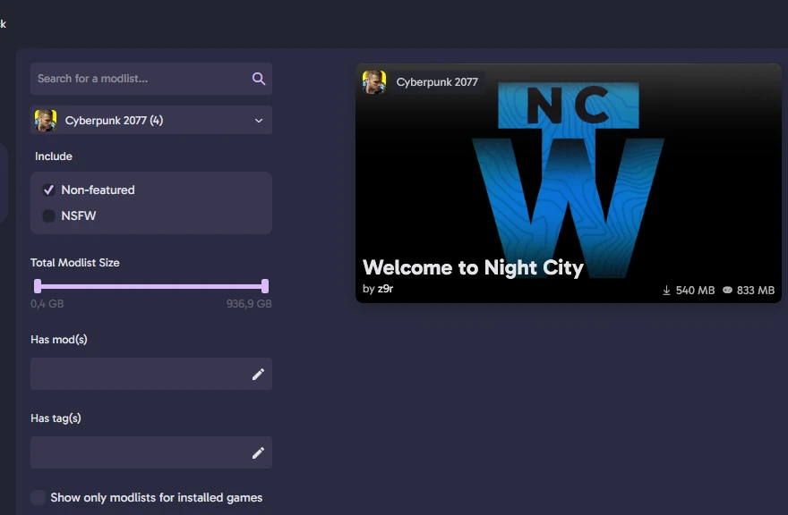

# Wabbajack Installation

## Installation

Once you have completed pre-installation, download the [latest version of Wabbajack](https://github.com/wabbajack-tools/wabbajack/releases/latest) and place it in a folder such as `C:\Games\Wabbajack`.

Downloading and installing No Man's Sky - Explorer can take a while. Follow the next steps:

1. Open Wabbajack and click on **Browse Modlists**.
2. Search for **No Man's Sky - Explorer**, or pick No Man's Sky in the game filter.
3. Under **Include**, tick **Non-featured** (this list is not a featured list) and leave **NSFW** unticked.
4. Press the download button and wait.
5. Set the installation folder to somewhere like `C:\Games\No Man's Sky - Explorer`.
6. Start the installation. Wabbajack first runs a checklist (game, Nexus login, downloads, disk space), then downloads and installs the list.
7. Wait until Wabbajack says the installation is complete.

 

**Even if Wabbajack says installation complete, this doesn't mean you have finished. You must follow the rest of the installation guide.**

# Installation Wabbajack

## Installation

Une fois la pré-installation terminée, téléchargez la [dernière version de Wabbajack](https://github.com/wabbajack-tools/wabbajack/releases/latest) et placez-la dans un dossier comme `C:\Games\Wabbajack`.

Le téléchargement et l'installation de No Man's Sky - Explorer peuvent prendre un certain temps. Suivez les étapes suivantes (l'interface de Wabbajack est en anglais) :

1. Ouvrez Wabbajack et cliquez sur **Browse Modlists**.
2. Recherchez **No Man's Sky - Explorer**, ou choisissez No Man's Sky dans le filtre de jeu.
3. Sous **Include**, cochez **Non-featured** (cette liste n'est pas mise en avant) et laissez **NSFW** décoché.
4. Appuyez sur le bouton de téléchargement et attendez.
5. Définissez le dossier d'installation quelque part comme `C:\Games\No Man's Sky - Explorer`.
6. Lancez l'installation. Wabbajack passe d'abord une liste de vérifications (jeu, connexion Nexus, téléchargements, espace disque), puis télécharge et installe la liste.
7. Attendez que Wabbajack indique que l'installation est terminée.

 

**Même si Wabbajack dit que l'installation est terminée, vous n'avez pas fini. Vous devez suivre le reste du guide d'installation.**

## Problems With Installation

- Restart Wabbajack if it seems stuck: it picks up where it left off, and files already downloaded are kept.
- Rerun Wabbajack at least twice before reporting failed downloads.

**Could not download x:**
Big files can fail due to connection issues (the biggest one in this list is No Man's Sound, about 1 GB). Retry the file or run Wabbajack again. If it keeps failing, download it by hand from its Nexus page and put it in the list's downloads folder.

## Problèmes d'Installation

- Redémarrez Wabbajack s'il semble bloqué : il reprend là où il s'était arrêté, et les fichiers déjà téléchargés sont conservés.
- Relancez Wabbajack au moins deux fois avant de signaler des échecs de téléchargement.

**Impossible de télécharger x :**
Les gros fichiers peuvent échouer à cause de problèmes de connexion (le plus gros de cette liste est No Man's Sound, environ 1 Go). Relancez le téléchargement du fichier ou relancez Wabbajack. S'il échoue encore, téléchargez-le à la main depuis sa page Nexus et placez-le dans le dossier des téléchargements de la liste.

