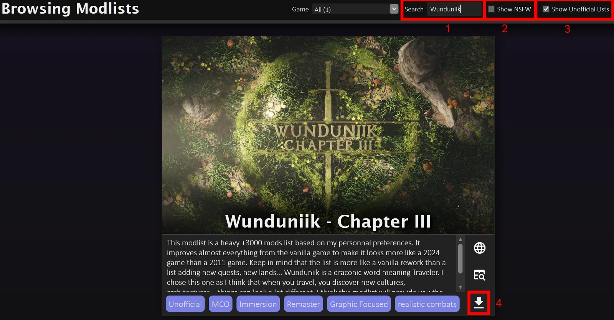
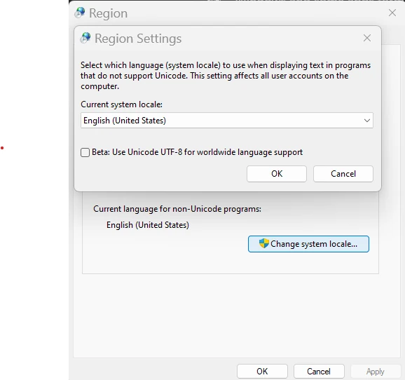

# Wabbajack Installation

## Installation

Once you have completed pre-installation, download the latest version of Wabbajack from [wabbajack.org](https://www.wabbajack.org/) and place it in a folder such as `C:\Games\Wabbajack`. Do not place it in program files, on your desktop or in your downloads folder. I recommend placing it on an SSD as it will work quicker on there.

Downloading and installing Wunduniik can take a while depending on your internet connection and computer. Follow the next steps to download and install Wunduniik properly:

1. Open Wabbajack and go to the **Gallery**.
2. Type **Wunduniik** in the search field.
3. Press the download button on Wunduniik and wait for the `.wabbajack` file to download.
4. Press the play button that replaces the download button.
5. Set the installation folder to somewhere like `C:\Games\Wunduniik`. Do not install it to your desktop or downloads folder.
6. Set the download location. It does not need to be on an SSD but it makes installing a bit faster, and it can be on another drive.
7. Start the installation. Wabbajack first runs a checklist (game, game files, Nexus login, manual downloads, disk space). Log in to Nexus when it asks: the login opens in your browser.
8. Without Nexus Premium, Wabbajack opens the download page of each file: press **Slow download** on each one. Wabbajack picks the files up from your browser's Downloads folder.
9. Go and pet your nearest fluffy animal whilst Wabbajack does its thing. Alternatively read through this readme again.
10. The installation is now complete. You can move on to the next section.

 

**Even if Wabbajack says installation complete, this doesn't mean you have finished. You must follow the rest of the installation guide in order to have the list working properly. Otherwise you will have big issues.**

**Installation Video:**

To help you if you're not comfortable with text guides, you can watch the following video covering generic instructions to correctly install any Wabbajack modlist:

# Installation Wabbajack

## Installation

Une fois la pré-installation terminée, téléchargez la dernière version de Wabbajack sur [wabbajack.org](https://www.wabbajack.org/) et placez-le dans un dossier comme `C:\Games\Wabbajack`. Ne le placez pas dans les fichiers programmes, sur votre bureau ou dans votre dossier de téléchargements. Je recommande de le placer sur un SSD car il fonctionnera plus rapidement.

Le téléchargement et l'installation de Wunduniik peuvent prendre un certain temps selon votre connexion internet et votre ordinateur. Suivez les étapes suivantes pour télécharger et installer Wunduniik correctement :

1. Ouvrez Wabbajack et allez dans la **Gallery** (galerie).
2. Tapez **Wunduniik** dans le champ de recherche.
3. Appuyez sur le bouton de téléchargement de Wunduniik et attendez la fin du téléchargement du fichier `.wabbajack`.
4. Appuyez sur le bouton lecture qui remplace le bouton de téléchargement.
5. Définissez le dossier d'installation quelque part comme `C:\Games\Wunduniik`. N'installez pas sur votre bureau ou dans votre dossier de téléchargements.
6. Définissez l'emplacement des téléchargements. Il n'a pas besoin d'être sur un SSD, mais cela accélère un peu l'installation, et il peut être sur un autre disque.
7. Lancez l'installation. Wabbajack commence par une liste de vérifications (jeu, fichiers du jeu, connexion Nexus, téléchargements manuels, espace disque). Connectez-vous à Nexus quand il le demande : la connexion s'ouvre dans votre navigateur.
8. Sans Nexus Premium, Wabbajack ouvre la page de téléchargement de chaque fichier : appuyez sur **Slow download** à chaque fois. Wabbajack récupère les fichiers dans le dossier Téléchargements de votre navigateur.
9. Allez caresser l'animal le plus proche pendant que Wabbajack fait son travail. Vous pouvez aussi relire ce guide.
10. L'installation est maintenant terminée. Vous pouvez passer à la section suivante.

 

**Même si Wabbajack dit que l'installation est terminée, cela ne signifie pas que vous avez fini. Vous devez suivre le reste du guide d'installation pour que la liste fonctionne correctement. Sinon vous aurez de gros problèmes.**

**Vidéo d'installation :**

Pour vous aider si vous n'êtes pas à l'aise avec les guides textuels, vous pouvez regarder la vidéo suivante qui couvre les informations génériques pour installer correctement n'importe quelle modlist Wabbajack :

  

    <iframe
      src="https://www.youtube.com/embed/Ongqbtsfnt0"
      frameborder="0"
      allow="accelerometer; autoplay; clipboard-write; encrypted-media; gyroscope; picture-in-picture"
      allowfullscreen
      style="position: absolute; top: 0; left: 0; width: 100%; height: 100%; border-radius: 12px;">
    </iframe>
  

## Problems With Installation

It is possible that you may encounter an error with Wabbajack when installing. Some common issues are listed below.

**Could not download x:**
Big files can fail to download due to connection issues. Wabbajack retries them; a file that still fails shows as a failed download with a retry button. You can also download the file manually: make sure to place it in the same place as the other downloads.

**Missing or wrong-version game files:**
Wabbajack checks your Skyrim files before installing. If it reports missing or wrong-version game files or Creation Club content, check that the Anniversary Edition upgrade is installed and the game language is English. Wabbajack can also download those files from Steam: log in to Steam inside Wabbajack when it offers it, and it puts them in the downloads folder.

**A French translation mod is failing to download:**
Some files use special characters such as "ç" and "ä" that can fail to download if your PC can't handle those. To fix this:
- Set your PC to English (United States)
- Disable "Use Unicode UTF-8"
- Restart the download. Once done you can revert those settings.

 

## Problèmes d'Installation

Il est possible que vous rencontriez une erreur avec Wabbajack lors de l'installation. Voici quelques problèmes courants.

**Impossible de télécharger x :**
Les gros fichiers peuvent échouer à télécharger en raison de problèmes de connexion. Wabbajack les retente ; un fichier qui échoue encore apparaît comme téléchargement échoué, avec un bouton pour réessayer. Vous pouvez aussi télécharger le fichier manuellement : placez-le au même endroit que les autres téléchargements.

**Fichiers du jeu manquants ou dans la mauvaise version :**
Wabbajack vérifie vos fichiers de Skyrim avant l'installation. S'il signale des fichiers du jeu ou du contenu Creation Club manquants ou dans la mauvaise version, vérifiez que la mise à niveau Anniversary Edition est installée et que le jeu est en anglais. Wabbajack peut aussi télécharger ces fichiers depuis Steam : connectez-vous à Steam dans Wabbajack quand il le propose, et il les place dans le dossier des téléchargements.

**Un mod de traduction française échoue au téléchargement :**
Certains fichiers utilisent des caractères spéciaux comme « ç » et « ä » qui peuvent échouer à télécharger si votre PC ne les prend pas en charge. Pour corriger cela :
- Définissez votre PC sur Anglais (États-Unis)
- Désactivez « Utiliser Unicode UTF-8 »
- Relancez le téléchargement. Une fois terminé, vous pouvez rétablir ces paramètres.

 

