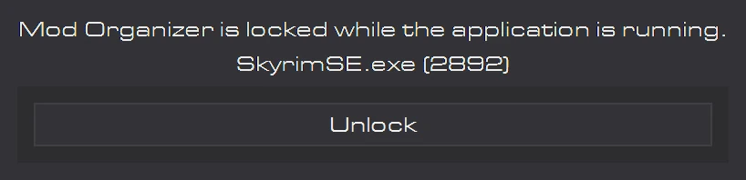

# Using The List

## Starting The List

Open `ModOrganizer.exe` in the list folder. Check that the profile **No Man's Sky - Explorer** is selected, then pick **No Man's Sky - Explorer Launcher** in the executables dropdown (top right) and press **Run**. This is a custom executable of the game's `Binaries\NMS.exe`.

At launch, the game shows a warning that it is running with mods: click to continue to the main menu. **THIS IS NORMAL, DON'T PANIC!**

{: .note }
You can create a desktop shortcut in the shortcuts dropdown.

{: .warning }
> Do not launch the game through Steam or GOG. This will launch vanilla No Man's Sky.

{: .warning }
> Add the list to your antivirus exceptions list.

## Do Not Click Unlock!

Mod Organizer locks your mods and load order while running an executable. Clicking unlock may corrupt your game experience.

  

## If Mods Do Not Load

- Open `Binaries\SETTINGS\GCMODSETTINGS.MXML` in the game folder and check that `DisableAllMods` is set to `false`. A big game update can switch all mods off.
- If mods still do not load, close the game and delete `GCMODSETTINGS.MXML`. The game writes a new one with default settings at the next launch.

## Updating

- Always check the [Changelog]({{ '/no-mans-sky-explorer/changelog/' | relative_url }}) before updating. Each version says whether it is save compatible.
- **Backup your saves** or start fresh after updates. No Man's Sky keeps its saves outside the list folder, in `%AppData%\HelloGames\NMS` (`st_<SteamID>` folder on Steam, `DefaultUser` on GOG): copy that folder before you update.
- Version 3.1.0.0 is save compatible, but it adds Nomad Biomes, whose author asks you to save at a space station before adding it to an existing save. Do that before updating.
- Wabbajack will delete all files not part of the modlist from the list folder when updating.

The full procedure, with what the update keeps and deletes: [Updating the List]({{ '/no-mans-sky-explorer/installation-guide/updating/' | relative_url }}).

## When The Game Updates

Hello Games patches No Man's Sky often. A game patch can stop some mods from working until their authors and the list are updated. After a patch, check the changelog and the Discord server before loading your main save.

# Utiliser la Liste

## Démarrer la Liste

Ouvrez `ModOrganizer.exe` dans le dossier de la liste. Vérifiez que le profil **No Man's Sky - Explorer** est sélectionné, puis choisissez **No Man's Sky - Explorer Launcher** dans la liste déroulante des exécutables (en haut à droite) et appuyez sur **Run**. C'est un exécutable personnalisé du fichier `Binaries\NMS.exe` du jeu.

Au lancement, le jeu affiche un avertissement indiquant qu'il tourne avec des mods : cliquez pour continuer jusqu'au menu principal. **C'EST NORMAL, NE PANIQUEZ PAS !**

{: .note }
Vous pouvez créer un raccourci bureau dans le menu déroulant des raccourcis.

{: .warning }
> Ne lancez pas le jeu via Steam ou GOG. Cela lancera No Man's Sky vanilla.

{: .warning }
> Ajoutez la liste aux exceptions de votre antivirus.

## Ne Cliquez Pas sur Déverrouiller !

Mod Organizer verrouille vos mods et l'ordre de chargement pendant l'exécution. Cliquer sur déverrouiller peut corrompre votre expérience de jeu.

  

## Si les Mods ne se Chargent Pas

- Ouvrez `Binaries\SETTINGS\GCMODSETTINGS.MXML` dans le dossier du jeu et vérifiez que `DisableAllMods` vaut `false`. Une grosse mise à jour du jeu peut désactiver tous les mods.
- Si les mods ne se chargent toujours pas, fermez le jeu et supprimez `GCMODSETTINGS.MXML`. Le jeu en recrée un avec les réglages par défaut au lancement suivant.

## Mise à Jour

- Consultez toujours le [journal des modifications]({{ '/no-mans-sky-explorer/changelog/' | relative_url }}) avant de mettre à jour. Chaque version indique si elle est compatible avec les sauvegardes existantes.
- **Sauvegardez vos parties** ou commencez une nouvelle partie après les mises à jour. No Man's Sky range ses sauvegardes hors du dossier de la liste, dans `%AppData%\HelloGames\NMS` (dossier `st_<SteamID>` sur Steam, `DefaultUser` sur GOG) : copiez ce dossier avant de mettre à jour.
- La version 3.1.0.0 est compatible avec les sauvegardes, mais elle ajoute Nomad Biomes, dont l'auteur demande de sauvegarder dans une station spatiale avant de l'ajouter à une partie existante. Faites-le avant la mise à jour.
- Wabbajack supprimera du dossier de la liste tous les fichiers ne faisant pas partie de la modlist lors des mises à jour.

La procédure complète, avec ce que la mise à jour garde et supprime : [Mettre à jour la liste]({{ '/no-mans-sky-explorer/installation-guide/updating/' | relative_url }}).

## Quand le Jeu se Met à Jour

Hello Games publie souvent des correctifs pour No Man's Sky. Un correctif du jeu peut empêcher certains mods de fonctionner jusqu'à ce que leurs auteurs et la liste soient mis à jour. Après un correctif, consultez le journal des modifications et le serveur Discord avant de charger votre partie principale.

