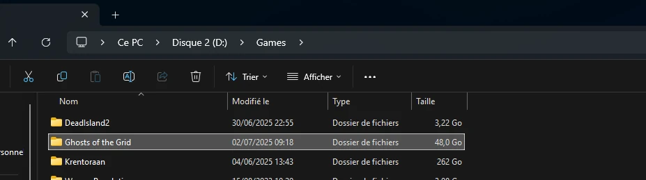

# Installation

## Pre-Installation

### Necessary Tweaks

Before installing the modlist, here are some things you must do.

There is no workaround for a pirated copy of No Man's Sky. If you ask for support with anything pirated, you will be banned.

1. **Update the game.** Install No Man's Sky from Steam or GOG and let it update to the current version (7.14 for list version 3.1.0.0). Wabbajack does not check the game version for this list, so this is on you.
2. **Launch the game once** from Steam or GOG, reach the main menu, then quit. This confirms the game installs and starts correctly before any mod is added.
3. **Remove mods you installed by hand.** The `GAMEDATA\MODS` folder inside the game folder must be empty. Mod Organizer adds the list's mods to it virtually, and anything left there by hand would load on top of the list.
4. **Hold back automatic game updates.** Hello Games patches the game often, and a patch can break mods until they are updated. In Steam: right-click No Man's Sky → **Properties** → **Updates** → **Only update this game when I launch it**. In GOG Galaxy: the settings button next to **Play** → **Manage installation** → **Configure** → untick automatic updates.

{: .warning}
> **WARNING**
>
> If your Steam library is in Program Files, move it elsewhere. Do not install the list in Windows managed folders (Program Files, Desktop, Documents, Downloads, etc.) as this will cause issues.

The list folder must be separate from both the game folder and the Wabbajack folder: do not install the list inside either of them. Keep the path short, for example `C:\Games\No Man's Sky - Explorer`: Windows limits file paths to 260 characters by default.

Here is an example of a well-configured games folder, with each modlist in its own folder directly under `D:\Games`:
 Games, each in its own folder" width="927" height="259">

**YOU SHALL NOT DOWNGRADE THE GAME! DOING SO WILL CAUSE INSTALLATION ISSUES.**

## Accounts and Websites

For the Wabbajack installation to proceed without issues, you must connect to or create accounts for:
- [Nexus Mods](https://www.nexusmods.com/): 224 of the list's 225 files come from Nexus Mods. Wabbajack opens the Nexus login in your web browser.
  - **Premium**: every file downloads automatically.
  - **Free account**: Wabbajack opens each file's Nexus page and you press **Slow download** for each one.

# Installation

## Pré-Installation

### Modifications Nécessaires

Avant d'installer la modlist, voici quelques choses que vous devez faire.

Il n'y a pas de solution de contournement pour une copie piratée de No Man's Sky. Si vous demandez de l'aide pour quoi que ce soit de piraté, vous serez banni.

1. **Mettez le jeu à jour.** Installez No Man's Sky depuis Steam ou GOG et laissez-le se mettre à jour vers la version actuelle (7.14 pour la version 3.1.0.0 de la liste). Wabbajack ne vérifie pas la version du jeu pour cette liste : c'est à vous de le faire.
2. **Lancez le jeu une fois** depuis Steam ou GOG, allez jusqu'au menu principal, puis quittez. Cela confirme que le jeu est installé et démarre correctement avant d'ajouter le moindre mod.
3. **Retirez les mods installés à la main.** Le dossier `GAMEDATA\MODS` du dossier du jeu doit être vide. Mod Organizer y ajoute les mods de la liste de façon virtuelle, et tout ce qui y a été déposé à la main se chargerait en plus de la liste.
4. **Bloquez les mises à jour automatiques du jeu.** Hello Games publie souvent des correctifs, et un correctif peut casser des mods tant qu'ils ne sont pas mis à jour. Dans Steam : clic droit sur No Man's Sky → **Propriétés** → **Mises à jour**, puis choisissez de ne mettre à jour le jeu qu'à son lancement (*Only update this game when I launch it* en anglais). Dans GOG Galaxy : bouton des réglages à côté du bouton de lancement → *Manage installation* → *Configure* → décochez les mises à jour automatiques.

{: .warning}
> **AVERTISSEMENT**
>
> Si votre bibliothèque Steam se trouve dans Program Files, déplacez-la ailleurs. N'installez pas la liste dans les dossiers gérés par Windows (Program Files, Bureau, Documents, Téléchargements, etc.) car cela causera des problèmes.

Le dossier de la liste doit être séparé du dossier du jeu et du dossier de Wabbajack : n'installez pas la liste à l'intérieur de l'un d'eux. Gardez un chemin court, par exemple `C:\Games\No Man's Sky - Explorer` : par défaut, Windows limite les chemins de fichiers à 260 caractères.

Voici un exemple de dossier de jeux bien organisé, avec chaque modlist dans son propre dossier directement sous `D:\Games` :
 Games, chacun dans son propre dossier" width="927" height="259">

**VOUS NE DEVEZ PAS RÉTROGRADER LE JEU ! CELA CAUSERA DES PROBLÈMES D'INSTALLATION.**

## Comptes et Sites Web

Pour que l'installation Wabbajack se déroule sans problème, vous devez vous connecter à ou créer des comptes sur :
- [Nexus Mods](https://www.nexusmods.com/) : 224 des 225 fichiers de la liste viennent de Nexus Mods. Wabbajack ouvre la connexion à Nexus dans votre navigateur.
  - **Premium** : tous les fichiers se téléchargent automatiquement.
  - **Compte gratuit** : Wabbajack ouvre la page Nexus de chaque fichier et vous appuyez sur **Slow download** pour chacun.

