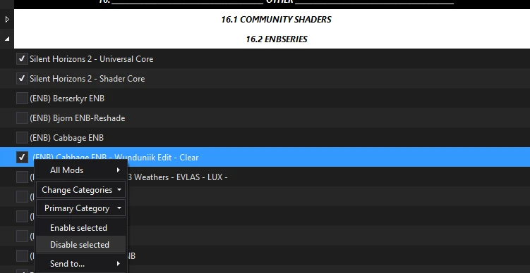
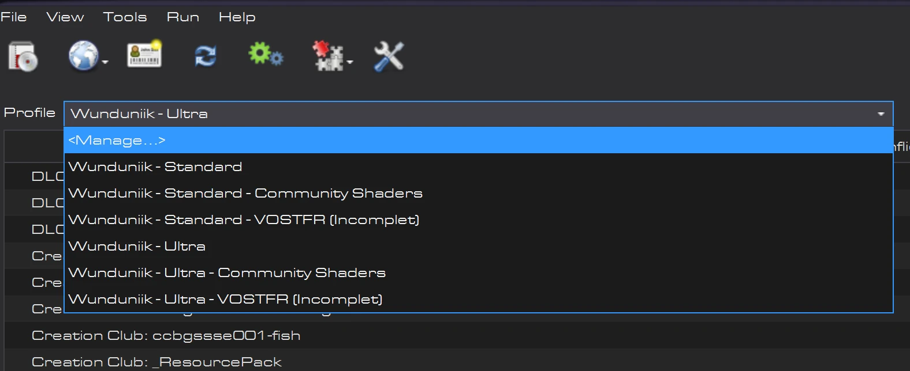

# Post Installation

## BethINI and INIs

BethINI is a really useful tool to edit your Skyrim.ini, SkyrimCustom.ini and SkyrimPrefs.ini. I already provided my INIs, but some lines might not be set up correctly for your computer. I advise you to make the changes by hand. Here are the lines you must check before starting your game:

1. SkyrimPrefs.ini (in the folder of the profile you use, under `profiles`):
   - `[Display]`
   - `iSize H=1440` → Change this to your screen resolution Height
   - `iSize W=2560` → Change this to your screen resolution Width
   - `[Launcher]`
   - `sD3DDevice="NVIDIA GeForce RTX 3090"` → Change this to your GPU name

2. SSEDisplayTweaks.ini: nothing to change for the resolution. The list includes Auto Resolution, which sets the game resolution to your Windows display resolution.

## Switching Preset

Wunduniik renders with Community Shaders (mod **Community Shaders AIO**, separator **16.2 COMMUNITY SHADERS**). It does not use the ENBSeries program: the presets in separator **16.1 ENBSERIES - PRESETS** are ENB-style presets that Community Shaders loads. **(ENB) NAT Effect 11** is enabled by default. Wunduniik uses Root Builder, which allows mods modifying game root to be installed as mods. To change the preset:

1. Disable the current active preset ((ENB) NAT Effect 11 by default):

    

2. Enable the preset you want to use from separator 16.1 ENBSERIES - PRESETS. Keep only one enabled: the presets replace the same files.

## Increasing Wunduniik Performance

### Profile Options

Wunduniik comes with 3 profiles: Performance, Standard, and Ultra. Mod Organizer picks one when it starts, based on your graphics card's VRAM. You can still switch profiles from the drop-down:
- **Performance** (less than 8 GB VRAM): Sparse Forest with less realistic trees and lower density flora
- **Standard** (8 to 12 GB VRAM): Sparse Forests with realistic trees and dense flora
- **Ultra** (12 GB VRAM or more): Dense Forests with realistic trees, ultra dense flora and Grass Lods

    

### SSE Display Tweaks

Use the server command `/displaytweaks` to see how to access this file.
- Set `BorderlessUpscale = True`. Remove the `#` if present.
- Remove the `#` from `#ResolutionScale=0.75`. You can adjust the 0.75 value to tweak scaling.

### Turn Off Effects In-Game

Wunduniik does not run ENBSeries, so there is no ENB menu. Open the Community Shaders menu instead: the list sets it to **Page Down**. Its effects can be turned off from there.

{: .warning }
> This method is not recommended as it will break visuals and some mod functions. Use only as a last resort.

### External Performance Tools

{: .note }
You are NOT forced to install any of these tools. They are provided as optional solutions.

- **Magpie Window Scaling Tool (free):** [https://github.com/Blinue/Magpie](https://github.com/Blinue/Magpie)
- **PureDark's DLSS Mod (~$5):** Search on Patreon or their Discord.
- **Lossless Scaling (~$7):** Available on Steam. Check the Guides section for setup.

# Post-Installation

## BethINI et INIs

BethINI est un outil très utile pour modifier vos fichiers Skyrim.ini, SkyrimCustom.ini et SkyrimPrefs.ini. J'ai déjà fourni mes INIs, mais certaines lignes pourraient ne pas être correctement configurées pour votre ordinateur. Je vous conseille de faire les modifications à la main. Voici les lignes à vérifier avant de démarrer le jeu :

1. SkyrimPrefs.ini (dans le dossier du profil que vous utilisez, sous `profiles`) :
   - `[Display]`
   - `iSize H=1440` → Remplacez par la hauteur de votre résolution d'écran
   - `iSize W=2560` → Remplacez par la largeur de votre résolution d'écran
   - `[Launcher]`
   - `sD3DDevice="NVIDIA GeForce RTX 3090"` → Remplacez par le nom de votre carte graphique

2. SSEDisplayTweaks.ini : rien à changer pour la résolution. La liste inclut Auto Resolution, qui règle la résolution du jeu sur celle de l'affichage de Windows.

## Changer de Preset

Wunduniik utilise Community Shaders pour le rendu (mod **Community Shaders AIO**, séparateur **16.2 COMMUNITY SHADERS**). Il n'utilise pas le programme ENBSeries : les presets du séparateur **16.1 ENBSERIES - PRESETS** sont des presets de type ENB chargés par Community Shaders. **(ENB) NAT Effect 11** est activé par défaut. Wunduniik utilise Root Builder, ce qui permet aux mods modifiant la racine du jeu d'être installés comme des mods. Pour changer de preset :

1. Désactivez le preset actif ((ENB) NAT Effect 11 par défaut) :

    

2. Activez le preset que vous souhaitez utiliser dans le séparateur 16.1 ENBSERIES - PRESETS. N'en gardez qu'un seul activé : les presets remplacent les mêmes fichiers.

## Améliorer les Performances de Wunduniik

### Options de Profils

Wunduniik est livré avec 3 profils : Performance, Standard et Ultra. Mod Organizer en choisit un à son lancement, selon la VRAM de votre carte graphique. Vous pouvez toujours changer de profil dans la liste déroulante :
- **Performance** (moins de 8 Go de VRAM) : Forêt clairsemée avec des arbres moins réalistes et une flore moins dense
- **Standard** (de 8 à 12 Go de VRAM) : Forêts clairsemées avec des arbres réalistes et une flore dense
- **Ultra** (12 Go de VRAM ou plus) : Forêts denses avec des arbres réalistes, flore ultra dense et LODs d'herbe

    

### SSE Display Tweaks

Utilisez la commande serveur `/displaytweaks` pour accéder à ce fichier.
- Définissez `BorderlessUpscale = True`. Retirez le `#` si présent.
- Retirez le `#` de `#ResolutionScale=0.75`. Vous pouvez ajuster la valeur 0.75 pour régler la mise à l'échelle.

### Désactiver les Effets En Jeu

Wunduniik n'utilise pas ENBSeries, il n'y a donc pas de menu ENB. Ouvrez plutôt le menu de Community Shaders : la liste le place sur **Page Down** (Page suivante). Ses effets peuvent y être désactivés.

{: .warning }
> Cette méthode n'est pas recommandée car elle cassera les visuels et certaines fonctions de mods. À utiliser uniquement en dernier recours.

### Outils de Performance Externes

{: .note }
Vous n'êtes PAS obligé d'installer ces outils. Ils sont fournis comme solutions optionnelles.

- **Magpie Window Scaling Tool (gratuit) :** [https://github.com/Blinue/Magpie](https://github.com/Blinue/Magpie)
- **Mod DLSS de PureDark (~5$) :** Recherchez sur Patreon ou leur Discord.
- **Lossless Scaling (~7$) :** Disponible sur Steam. Consultez la section Guides pour la configuration.

