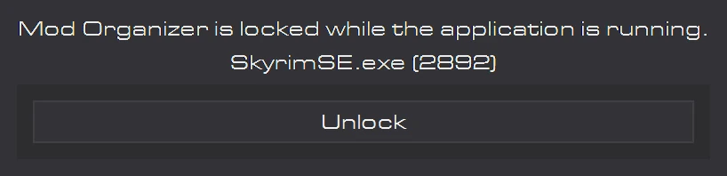
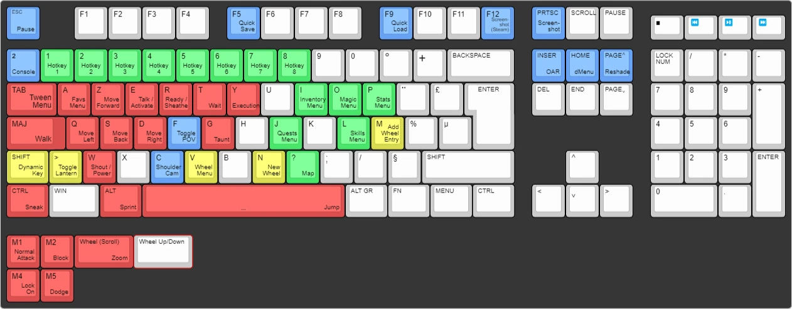

# Using The List

## Starting The List

Open `ModOrganizer.exe` in the Wunduniik install folder and launch **Wunduniik Launcher** through the executables. It should be already automatically selected. This is a custom executable of SKSE. As the modlist is quite big, it may take some time to load the game depending on your PC. **THIS IS NORMAL, DON'T PANIC!**

{: .note }
You can create a desktop shortcut in the shortcuts dropdown.

{: .warning }
> Do not launch the game through Steam. This will launch vanilla Skyrim.

{: .warning }
> Add the list to your antivirus exceptions list as it may otherwise stop it from working.

## Do Not Click Unlock!

Mod Organizer locks your mods, load order, and other executables while running an executable. This is to prevent the user from making changes while the game is running. Clicking unlock may corrupt your game experience.

  

## Configuring MCM

All MCMs have been pre-configured with MCM Memory, however you can change settings if you don't like them. When you start a new game, MCM Memory waits for the MCMs to register, then restores the list's settings (profile **Wunduniik Reloaded**). **BE CAREFUL!** Automatic backup is on: when you change an MCM setting, the change is saved into that profile and replaces the list's value. Make sure to note what was set by default before making changes.

{: .warning }
> Failure to wait for MCMs to finish loading can cause issues later on and will require you to start a new save.

## Keymapping

Here is a keybind map of most of the shortcuts used in-game:

  

The keymap is also available in-game using the **F8** key. Press Tab to close it. The [Controls]({{ '/wunduniik/game-guide/controls/' | relative_url }}) page of the Game Guide lists the binds key by key.

# Utiliser la Liste

## Démarrer la Liste

Ouvrez `ModOrganizer.exe` dans le dossier d'installation de Wunduniik et lancez **Wunduniik Launcher** via les exécutables. Il devrait être déjà sélectionné automatiquement. C'est un exécutable personnalisé de SKSE. Comme la modlist est assez grande, le chargement du jeu peut prendre un certain temps selon votre PC. **C'EST NORMAL, NE PANIQUEZ PAS !**

{: .note }
Vous pouvez créer un raccourci bureau dans le menu déroulant des raccourcis.

{: .warning }
> Ne lancez pas le jeu via Steam. Cela lancera Skyrim vanilla.

{: .warning }
> Ajoutez la liste aux exceptions de votre antivirus car il pourrait l'empêcher de fonctionner.

## Ne Cliquez Pas sur Déverrouiller !

Mod Organizer verrouille vos mods, l'ordre de chargement et les autres exécutables pendant qu'un exécutable est en cours d'exécution. Cela empêche l'utilisateur de faire des modifications pendant que le jeu tourne. Cliquer sur déverrouiller peut corrompre votre expérience de jeu.

  

## Configuration des MCM

Tous les MCM ont été préconfigurés avec MCM Memory, mais vous pouvez modifier les paramètres si vous ne les aimez pas. Quand vous commencez une nouvelle partie, MCM Memory attend que les MCM soient enregistrés, puis restaure les réglages de la liste (profil **Wunduniik Reloaded**). **ATTENTION !** La sauvegarde automatique est activée : quand vous modifiez un réglage MCM, le changement est enregistré dans ce profil et remplace la valeur de la liste. Notez ce qui était défini par défaut avant de faire des changements.

{: .warning }
> Ne pas attendre que les MCM finissent de se charger peut causer des problèmes et vous obligera à recommencer une nouvelle sauvegarde.

## Raccourcis Clavier

Voici une carte des raccourcis les plus utilisés en jeu :

  

La carte des touches est également disponible en jeu en appuyant sur la touche **F8**. Appuyez sur Tab pour la fermer. La page [Commandes]({{ '/wunduniik/game-guide/controls/' | relative_url }}) du Guide de jeu détaille les touches une par une.

