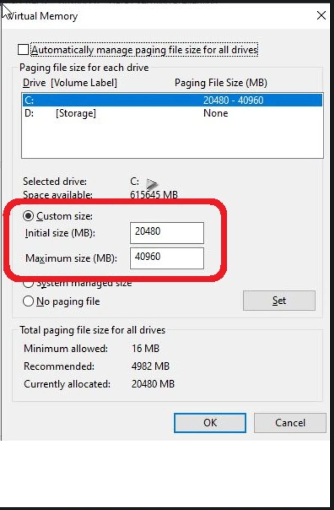
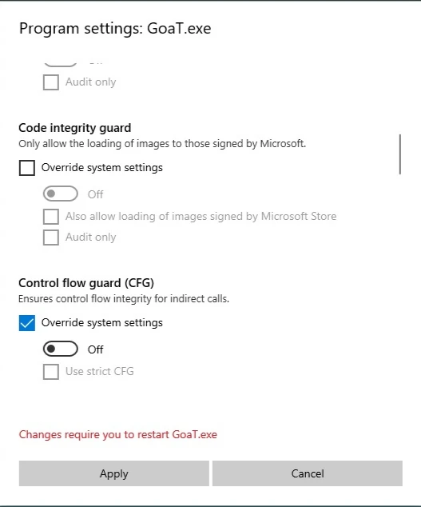

# System Requirements & Necessary Tools

## System Requirements

Only Windows 10 and 11 fully support Wabbajack. LTSC, special variants, lightened editions or any other modified variant **WILL NOT WORK**. Your Windows version **must be 21H2 or newer** to run both Wabbajack and No Man's Sky Explorer.

Running the list from Hard Disk Drives or external drives is **STRONGLY ADVISED AGAINST**.

As No Man's Sky Explorer is a modlist based on graphics, you must have a good graphics card.

# Configuration Requise & Outils Nécessaires

## Configuration Requise

Seuls Windows 10 et 11 prennent entièrement en charge Wabbajack. Les variantes LTSC, éditions spéciales ou allégées **NE FONCTIONNERONT PAS**. Votre version de Windows **doit être 21H2 ou plus récente**.

Exécuter la liste depuis des disques durs (HDD) ou des lecteurs externes est **FORTEMENT DÉCONSEILLÉ**.

Comme No Man's Sky Explorer est une modlist axée sur les graphismes, vous devez disposer d'une bonne carte graphique.

<strong>Space required:</strong> Loading... in total, including Loading... for the install and Loading... for the downloads.

<strong>Espace nécessaire :</strong> Loading... au total, dont Loading... pour l'installation et Loading... pour les téléchargements.

> If space is tight, you can delete the downloads folder once the list is installed. Wabbajack will download those files again at the next list update.
{: .note }

| Configuration         | CPU        | GPU                | RAM          | Storage                | Display          | FPS  |
|-----------------------|------------|--------------------|--------------|------------------------|------------------|------|
| **Minimum Specs**     | i5-7600k   | Nvidia RTX 2060    | 16 GB DDR4   | SATA SSD, space above  | FHD 60 Hz        | 45   |
| **Recommended Specs** | i7-9700k   | Nvidia RTX 3060 Ti | 32 GB DDR4   | 1 TB SATA III/M.2 SSD  | FHD 60 Hz        | 60+  |
| **Author's Specs**    | i5-10400f  | Nvidia RTX 3090    | 32 GB DDR4   | 1 TB M.2 SSD           | 2K 180 Hz        | 60+  |

## Necessary And Useful Applications

- [Wabbajack](https://github.com/wabbajack-tools/wabbajack/releases/latest): always use the latest release (4.3.2.2 on November 5, 2026). Wabbajack ships its own .NET runtime, so you do not need to install .NET separately.
- [Visual C++ Redistributable x64](https://aka.ms/vc14/vc_redist.x64.exe), latest supported version from Microsoft.

## PageFile Configuration

No Man's Sky with mods uses more memory than the vanilla game. **Never disable the pagefile.** If the game crashes while loading, give Windows a fixed pagefile:

1. Press **Windows + R** → type `sysdm.cpl,3` → **Enter**
2. **Performance** → **Settings** → **Advanced** → **Virtual memory** → **Change…**
3. Disable **Automatically manage...** → **Custom size:** Initial 20480 / Maximum 40960
4. **Set** → **Apply** → **OK** → Restart

## Exclusions and AntiVirus

- Exclude **1)** `NMS.exe` (in `Binaries`), **2)** the game folder, and **3)** the shader cache folder (`GAMEDATA\SHADERCACHE` in the game folder) from your antivirus
- Exclude from Control Flow Guard: Start → **Exploit Protection** → **Program Settings** → Add **NMS.exe** → **Control flow guard (CFG)** → **Override** → **Off**

> Si la place manque, vous pouvez supprimer le dossier des téléchargements une fois la liste installée. Wabbajack retéléchargera ces fichiers à la prochaine mise à jour de la liste.
{: .note }

| Configuration          | CPU        | GPU                 | RAM          | Stockage               | Écran            | FPS  |
|------------------------|------------|---------------------|--------------|------------------------|------------------|------|
| **Config. Minimum**    | i5-7600k   | Nvidia RTX 2060     | 16 Go DDR4   | SSD SATA, place ci-dessus | FHD 60 Hz        | 45   |
| **Config. Recommandée**| i7-9700k   | Nvidia RTX 3060 Ti  | 32 Go DDR4   | 1 To SATA III/M.2 SSD  | FHD 60 Hz        | 60+  |
| **Config. de l'Auteur**| i5-10400f  | Nvidia RTX 3090     | 32 Go DDR4   | 1 To M.2 SSD           | 2K 180 Hz        | 60+  |

## Applications Nécessaires et Utiles

- [Wabbajack](https://github.com/wabbajack-tools/wabbajack/releases/latest) : utilisez toujours la dernière version (4.3.2.2 au 5 novembre 2026). Wabbajack embarque son propre environnement .NET, vous n'avez donc pas besoin d'installer .NET à part.
- [Visual C++ Redistributable x64](https://aka.ms/vc14/vc_redist.x64.exe), dernière version prise en charge par Microsoft.

## Configuration du Fichier d'Échange

No Man's Sky avec des mods utilise plus de mémoire que le jeu de base. **Ne désactivez jamais le fichier d'échange.** Si le jeu plante au chargement, donnez à Windows un fichier d'échange fixe :

1. **Windows + R** → tapez `sysdm.cpl,3` → **Entrée**
2. **Performances** → **Paramètres** → **Avancé** → **Mémoire virtuelle** → **Modifier…**
3. Désactivez **Gérer automatiquement...** → **Taille personnalisée :** Initial 20480 / Maximum 40960
4. **Définir** → **Appliquer** → **OK** → Redémarrez

## Exclusions et Antivirus

- Excluez de votre antivirus **1)** `NMS.exe` (dans `Binaries`), **2)** le dossier du jeu, et **3)** le dossier du cache de shaders (`GAMEDATA\SHADERCACHE` dans le dossier du jeu)
- Excluez du Control Flow Guard : Démarrer → **Protection contre les attaques** → **Paramètres du programme** → Ajoutez **NMS.exe** → **Protection du flux de contrôle (CFG)** → **Remplacer** → **Désactivé**

